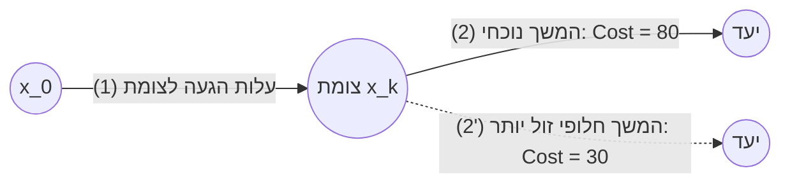

# חוברת העמקה והסברים פדגוגיים – הרצאה 1: מבוא מתמטי ותכנות דינמי בזמן בדיד

> **קורס:** בקרה אופטימלית (Optimal Control)  
> **מסמך נלווה ל:** `סיכום_לוח_הרצאה_1_מלא.md`  
> **מטרה:** ביאור מעמיק, אינטואיציה הנדסית-פיזיקלית, מילון סימונים ופירוק צעד-אחר-צעד של החישובים שבוצעו על הלוח.

---

## תוכן עניינים
1. [חלק 0: התשתית המתמטית – אופרטורים, פונקציונלים וחשבון וריאציות](#חלק-0-התשתית-המתמטית--אופרטורים-פונקציונלים-וחשבון-וריאציות)
   * [1.1 אופרטורים (Operators)](#11-אופרטורים-operators)
   * [1.2 פונקציונלים (Functionals)](#12-פונקציונלים-functionals)
   * [1.3 נגזרת מכוונת (גאטו / פרשה) ותנאי קיצון הכרחי](#13-נגזרת-מכוונת-גאטו--פרשה-ותנאי-קיצון-הכרחי)
   * [1.4 מינימיזציה של תבנית ריבועית ואינטואיציה גיאומטרית](#14-מינימיזציה-של-תבנית-ריבועית-ואינטואיציה-גיאומטרית)
   * [1.5 פסקת גישור מרכזית: מדוע המרצה עבר מכאן בחדות לזמן בדיד?](#15-פסקת-גישור-מרכזית-מדוע-המרצה-עבר-מכאן-בחדות-לזמן-בדיד)
2. [חלק A: ניסוח בעיית הבקרה האופטימלית בזמן בדיד](#חלק-a-ניסוח-בעיית-הבקרה-האופטימלית-בזמן-בדיד)
   * [2.1 מודל מרחב המצב הבדיד ודינמיקת המערכת](#21-מודל-מרחב-המצב-הבדיד-ודינמיקת-המערכת)
   * [2.2 פונקציית המחיר (Cost Functional) והטרייד-אוף ההנדסי](#22-פונקציית-המחיר-cost-functional-והטרייד-אוף-ההנדסי)
   * [2.3 אילוצים על המצב והבקרה](#23-אילוצים-על-המצב-והבקרה)
   * [2.4 פסקת גישור: יש לנו מודל ומטרה – כיצד פותרים את הבעיה?](#24-פסקת-גישור-יש-לנו-מודל-ומטרה--כיצד-פותרים-את-הבעיה)
3. [חלק B: עקרון האופטימליות של בלמן (Dynamic Programming)](#חלק-b-עקרון-האופטימליות-של-בלמן-dynamic-programming)
   * [3.1 הרעיון המרכזי של ריצ'רד בלמן והוכחה באינטואיציה](#31-הרעיון-המרכזי-של-ריצרד-בלמן-והוכחה-באינטואיציה)
   * [3.2 עץ מסלולים: מדוע אלגוריתם חמדני נכשל?](#32-עץ-מסלולים-מדוע-אלגוריתם-חמדני-נכשל)
   * [3.3 מושג ה-Cost-to-Go ואינדוקציה לאחור (Backward Induction)](#33-מושג-ה-cost-to-go-ואינדוקציה-לאחור-backward-induction)
4. [חלק C: פירוק מפורט של דוגמאות החישוב מההרצאה](#חלק-c-פירוק-מפורט-של-דוגמאות-החישוב-מההרצאה)
   * [4.1 דוגמה 2 מהלוח: פתרון מלא של רשת Trellis (3 מצבים, 3 שלבים)](#41-דוגמה-2-מהלוח-פתרון-מלא-של-רשת-trellis-3-מצבים-3-שלבים)
   * [4.2 פסקת גישור ומעבר למרחב רציף: דוגמה 3 מהלוח (מערכת לא-לינארית ובקרת Deadbeat)](#42-פסקת-גישור-ומעבר-למרחב-רציף-דוגמה-3-מהלוח-מערכת-לא-לינארית-ובקרת-deadbeat)
5. [סיכום עקרונות הברזל ומפת דרכים להמשך הקורס](#סיכום-עקרונות-הברזל-ומפת-דרכים-להמשך-הקורס)

---

## חלק 0: התשתית המתמטית – אופרטורים, פונקציונלים וחשבון וריאציות

### 1.1 אופרטורים (Operators)

#### מוטיבציה ורקע
בבקרה קלאסית אנו רגילים לעבוד עם פונקציות שממפות מספר למספר (למשל פונקציית תמסורת $G(s)$). בבקרה מודרנית ואופטימלית, המערכת ההנדסית מקבלת אות כניסה רציף בזמן (ווקטור בקרה שלם) ומייצרת אות יציאה לאורך זמן.
כדי לטפל במתמטיקה כזו, אנו זקוקים למושג הכללי של **אופרטור**: העתקה שמקבלת איבר ממרחב וקטורי אחד ומחזירה איבר במרחב וקטורי אחר.

#### מילון מונחים וסימונים
* **מרחב המוצא $\mathcal{X}$ ומרחב היעד $\mathcal{Y}$:** מרחבים וקטוריים (יכולים להיות מממד סופי כמו $\mathbb{R}^n$, או ממד אינסופי כמו מרחב הפונקציות הרציפות $C[0, T]$).
* **חתימת האופרטור:** $F : \mathcal{X} \longrightarrow \mathcal{Y}$ (הצהרה על תחום וטווח).
* **פעולת ההשמה (Mapping):** $x \longmapsto y = F(x)$ (האיבר $x$ מועבר לאיבר $y$). שימו לב לחץ עם הקו האנכי ($\longmapsto$) המציין פעולה על איברים ספציפיים.

#### השוואת שתי הדוגמאות מהלוח

1. **אופרטור לינארי סטטי בממד סופי ($\mathbb{R}^2 \to \mathbb{R}^3$):**

$$y = \begin{bmatrix} 1 & 0 \\ 0 & 1 \\ -2 & -1 \end{bmatrix} x$$

זהו שילוב לינארי פשוט: כל רכיב במוצא הוא סכום משוקלל של רכיבי הכניסה. אין כאן זיכרון ואין ציר זמן.

2. **אופרטור אינטגרלי דינמי (מרחב פונקציות אינסופי):**

$$y(t) = \int_0^T e^{A\xi} B x(\xi)\, d\xi$$

כאן $x(\xi)$ היא פונקציית בקרה שלמה לאורך הזמן $[0, T]$, והמוצא $y(t)$ משקלל את כל היסטוריית הכניסה דרך מטריצת המעבר הדינמית $e^{A\xi}$. זהו בדיוק אינטגרל הקונבולוציה של משוואת המצב!

---

### 1.2 פונקציונלים (Functionals)

#### מהו פונקציונל ומדוע הוא לב הבקרה האופטימלית?
פונקציונל הוא מקרה פרטי קריטי של אופרטור: הוא ממפה מרחב וקטורי שלם אל **הסקלרים הממשיים** $\mathbb{R}$:

$$f : \mathcal{X} \longrightarrow \mathbb{R}$$

> [!IMPORTANT]
> **האינטואיציה ההנדסית של פונקציונל:**
> פונקציונל הוא "מדד הציון" או "העלות הכוללת" של משימה הנדסית.
> נותנים לו מסלול טיסה שלם של כטב"ם, פרופיל מהירויות שלם, או אות זרם במנוע – והוא מחזיר מספר יחיד שמייצג: "כמה דלק נשרף?", "כמה סטינו מהמסלול?", או "כמה זמן ארכה המשימה?".

#### שלוש צורות יסוד של פונקציונלים:

* **תבנית ריבועית במרחב סופי ($\mathbb{R}^n$):**

$$f(\underline{x}) = \underline{x}^T Q \underline{x} = \sum_{i=1}^n \sum_{j=1}^n q_{ij} x_i x_j$$

* **פונקציונל אינטגרלי ריבועי ברציף ($\mathcal{L}_2^n[0, T]$):**

$$f(\underline{x}(t)) = \int_0^T \underline{x}^T(t) Q \underline{x}(t)\, dt$$

* **פונקציונל סדרות בבדיד ($\ell_2$):**

$$f(\{x_k\}) = \sum_{k=0}^{\infty} x_k^2$$

---

### 1.3 נגזרת מכוונת (גאטו / פרשה) ותנאי קיצון הכרחי

#### השאלה המתמטית היסודית
בחדו"א של משתנה בודד, כדי למצוא נקודת קיצון גוזרים ומשווים לאפס ($f'(x) = 0$).
אבל איך גוזרים פונקציונל שהקלט שלו הוא וקטור בעל $n$ ממדים, או גרוע מכך – פונקציה רציפה שלמה בזמן?

#### הרעיון של גאטו (Gateaux Derivative)
נבחר כיוון בדיקה שרירותי כלשהו $h \in \mathcal{X}$ (הפרעה אפשרית סביב הנקודה $x$).
נגדיר משתנה סקלרי קטן $\epsilon \in \mathbb{R}$ שקובע כמה "נצעד" בכיוון $h$:

$$g(\epsilon) \triangleq f(x + \epsilon h)$$

כעת הפכנו את הבעיה לפונקציה סקלרית רגילה של משתנה יחיד $\epsilon$!

```
         f(x + εh)
             ▲
             │       /
             │      /  שיפוע ב-ε=0
             │     /   הוא הנגזרת המכוונת
             │    /
             │   ● (f(x))
             └──────────────► ε
               ε=0
```

#### הגדרה פורמלית:

$$f'_\epsilon(h)\Big|_{\epsilon=0} \triangleq \lim_{\epsilon \to 0} \frac{f(x + \epsilon h) - f(x)}{\epsilon} = \frac{d}{d\epsilon} f(x + \epsilon h)\Bigg|_{\epsilon=0}$$

#### התנאי ההכרחי לאופטימום:
אם נקודה $x^*$ היא מינימום מקומי, אזי מכל כיוון שרירותי $h$ שבו "נביט", השיפוע הרגעי חייב להתאפס:

$$f'_\epsilon(h)\Big|_{\epsilon=0} = 0 \qquad \forall h \in \mathcal{X}$$

---

### 1.4 מינימיזציה של תבנית ריבועית ואינטואיציה גיאומטרית

המרצה הציג על הלוח הוכחה מתמטית אלגנטית למציאת המינימום של תבנית ריבועית:

$$f(\underline{x}) = \underline{x}^T Q \underline{x}, \qquad Q = Q^T > 0$$

נפעיל את מבחן ההפרעה בכיוון $\underline{h} \in \mathbb{R}^n$:

$$f(\underline{x} + \epsilon \underline{h}) = (\underline{x} + \epsilon \underline{h})^T Q (\underline{x} + \epsilon \underline{h}) = \underline{x}^T Q \underline{x} + \epsilon \underline{x}^T Q \underline{h} + \epsilon \underline{h}^T Q \underline{x} + \epsilon^2 \underline{h}^T Q \underline{h}$$

מכיוון ש-$Q$ סימטרית ($Q = Q^T$), האיברים המעורבים שווים:

$$\underline{h}^T Q \underline{x} = (\underline{h}^T Q \underline{x})^T = \underline{x}^T Q^T \underline{h} = \underline{x}^T Q \underline{h}$$

לכן:

$$f(\underline{x} + \epsilon \underline{h}) = \underline{x}^T Q \underline{x} + 2\epsilon \underline{x}^T Q \underline{h} + \epsilon^2 \underline{h}^T Q \underline{h}$$

נגזור לפי $\epsilon$ ונציב $\epsilon = 0$:

$$\frac{d}{d\epsilon} f(\underline{x} + \epsilon \underline{h})\Bigg|_{\epsilon=0} = 2\underline{x}^T Q \underline{h}$$

לפי התנאי ההכרחי, ביטוי זה חייב להתאפס **לכל וקטור הפרעה $\underline{h}$**:

$$2\underline{x}^T Q \underline{h} = 0 \quad \forall \underline{h} \implies \underline{x}^T Q = \underline{0}^T$$

מאחר ש-$Q > 0$ היא חיובית מוגדרת (ולכן מטריצה הפיכה ללא ערכים עצמיים אפסיים):

$$\underline{x}^* = \underline{0}$$

> [!NOTE]
> **משמעות גיאומטרית (פרבולואיד תלת-ממדי):**
> עבור $n=2$ ו-$Q = I$, הפונקציה היא $f(x_1, x_2) = x_1^2 + x_2^2$. זהו קערור (פרבולואיד סביב הראשית).
> קווי הגובה (Contour lines) הם מעגלים סביב הראשית.
> כאשר $Q$ בעלת ערכים עצמיים שונים $\lambda_1 \ne \lambda_2$, קווי הגובה הופכים לאליפסות מתוחות, כאשר צירי האליפסה מקבילים לווקטורים העצמיים של $Q$.

---

### 1.5 פסקת גישור מרכזית: מדוע המרצה עבר מכאן בחדות לזמן בדיד?

> [!IMPORTANT]
> **הערת גישור לקורא – חיבור הנקודות בתמונה הגדולה:**
> בדקה ה-52:00 של ההרצאה, לאחר שסיים להסביר על אליפסות ומינימום של תבנית ריבועית, המרצה מוחק את הלוח ופותח פרק חדש לחלוטין: **"חלק A: בקרה אופטימלית – זמן בדיד ותכנות דינמי"**.
> 
> עבור סטודנט הצופה בהרצאה, מעבר זה עשוי להיראות פתאומי ותלוש:
> *לאן נעלמו פתאום נגזרות גאטו והאופרטורים האינטגרליים הרציפים? למה המרצה לא המשיך לפתור בעיות בקרה בעזרת הנגזרת המכוונת שהרגע לימד?*
> 
> **הרציונל הדידקטי של המרצה והמבנה הלוגי של הקורס:**
> 1. **חלק 0 היה "ארגז כלים" רציף להמשך הסמסטר:** הכלים שהוצגו בחלק 0 (פונקציונלים ונגזרת גאטו) שייכים לענף של **חשבון וריאציות (Calculus of Variations)**. כלים אלו מיועדים לטפל בבקרה אופטימלית *בזמן רציף* (משוואות אוילר-לגרנז' ועקרון המקסימום של פונטריאגין). אולם, פתרון ישיר בזמן רציף מוביל למשוואות דיפרנציאליות מצומדות עם תנאי שפה בשני קצוות (Two-Point Boundary Value Problem - TPBVP) – מתמטיקה כבדה ומורכבת מאוד שהמרצה מעדיף לדחות לשלבים מתקדמים בקורס.
> 2. **מדוע פותחים את ליבת הבקרה דווקא בזמן בדיד (Discrete Time)?**
>    * **התאמה לעולם המעשי:** מחשבי טיסה, כרטיסי בקרה ומיקרו-בקרים ספרתיים פועלים כולם בדגימה בדידה ($t = k \cdot T_s$).
>    * **פשטות מתמטית ואלגוריתמית:** בזמן בדיד אין צורך לפתור משוואות דיפרנציאליות קשות. התנועה מיוצגת ע"י משוואת הפרשים פשוטה ($x_{k+1} = A_k x_k + B_k u_k$).
>    * **אינטואיציה עמוקה לבקרת משוב (Feedback):** גישת **התכנות הדינמי (Dynamic Programming)** של בלמן בזמן בדיד ממחישה בצורה גרפית ואלגוריתמית מבריקה מדוע אלגוריתמים מקומיים נכשלים, וכיצד חישוב לאחור מייצר חוק בקרת משוב אופטימלי לכל מצב עתידי.
> 3. **איך התבנית הריבועית שלמדנו בחלק 0 מתחברת מיד לחלק A?**
>    התבנית הריבועית $\underline{x}^T Q \underline{x}$ שנחקרה בפרק 0.4 אינה תרגיל מופשט! היא משמשת כעת ישירות כאבן הבניין של **פונקציית המחיר** בזמן בדיד:
>    בכל צעד זמן $k$, שגיאת המצב נקנסת ע"י התבנית הריבועית $\|x_{k+1} - x_d\|_Q^2 = (x_{k+1}-x_d)^T Q (x_{k+1}-x_d)$, ומאמץ הבקרה נקנס ע"י $\|u_k\|_R^2 = u_k^T R u_k$.

---

## חלק A: ניסוח בעיית הבקרה האופטימלית בזמן בדיד

### 2.1 מודל מרחב המצב הבדיד ודינמיקת המערכת

#### משוואות הדינמיקה מהלוח:

$$\begin{cases} x_{k+1} = A_k x_k + B_k u_k \\ z_{k+1} = H_{k+1} x_{k+1} \end{cases}$$

#### מילון משתנים וממדים
* $x_k \in \mathbb{R}^n$: **וקטור המצב בזמן $k$**. מייצג את הזיכרון המלא של המערכת. במערכת פיזיקלית (כגון רחפן או טיל), $x_k$ מכיל מיקום, מהירות קווית, זוויות גוף ומהירויות זוויתיות.
* $u_k \in \mathbb{R}^m$: **וקטור הבקרה / המפעילים בזמן $k$**. כוחות, מומנטים, מתחי מנועים או זוויות ספי כנף. בדרך כלל ממד הבקרה קטן מממד המצב ($m \le n$).
* $A_k \in \mathbb{R}^{n \times n}$: **מטריצת הדינמיקה הטבעית** (איך המערכת מתפתחת ללא התערבות בקרה).
* $B_k \in \mathbb{R}^{n \times m}$: **מטריצת השפעת הבקרה** (איך המפעילים משפיעים על נגזרות המצב).
* $z_{k+1} \in \mathbb{R}^p$: **וקטור המדידות / החיישנים** (גירוסקופ, מד תאוצה, GPS).
* $H_{k+1} \in \mathbb{R}^{p \times n}$: **מטריצת המדידה**.

#### תרשים זרימת הזמן ואינדקס הבקרה האחרונה
נקודה שהמרצה הדגיש במפורש על הלוח: האופק נמשך מ-$k=0$ עד $k=N$.
המצב ההתחלתי $x_0$ נתון וידוע. המצב הסופי של המשימה הוא $x_N$.

```
  x_0           x_1           x_2                   x_{N-1}          x_N
   ●─────────────┼─────────────┼──────── ... ──────────┼──────────────●
  k=0           k=1           k=2                    k=N-1           k=N
   │             │             │                       │              │
   ▼             ▼             ▼                       ▼              ▼
  u_0           u_1           u_2                    u_{N-1}        (אין u_N!)
```

> [!WARNING]
> **מדוע $u_N$ מחוק על הלוח ואינו קיים?**
> הבקרה $u_k$ נועדה להעביר את המערכת ממצב $x_k$ למצב הבא $x_{k+1}$.
> הבקרה האחרונה שמשפיעה על משהו בתוך חלון הזמן של הבעיה היא $u_{N-1}$, שקובעת את המצב הסופי $x_N$.
> בקרה בזמן $k=N$ הייתה משפיעה רק על $x_{N+1}$, שנמצא מחוץ לאופק התכנון של המשימה. לכן אין משמעות ל-$u_N$.

---

### 2.2 פונקציית המחיר (Cost Functional) והטרייד-אוף ההנדסי

פונקציית המחיר הריבועית (LQR - Linear Quadratic Regulator) שהוצגה על הלוח:

$$J = \sum_{k=0}^{N-1} \Big( \|x_{k+1} - x_d\|_Q^2 + \|u_k\|_R^2 \Big)$$

כאשר הנורמה המשוקללת מוגדרת כ:

$$\|v\|_M^2 \triangleq v^T M v$$

#### פירוק הטרייד-אוף ההנדסי (The Engineering Trade-off)

1. **איבר שגיאת המעקב ($\|x_{k+1} - x_d\|_Q^2$):**
   * קונס את המערכת על סטייה ממסלול היעד $x_d$.
   * המטריצה $Q$ שוקלת את החשיבות היחסית של כל שגיאה. למשל, אם רוצים דיוק קיצוני במיקום ופחות אכפת ממהירות, האיברים באלכסון של $Q$ השייכים למיקום יהיו גדולים משמעותית.
   * **דרישה מתמטית:** $Q = Q^T \ge 0$ (חיובית חצי-מוגדרת). מותר שחלק מהמצבים לא יקבלו קנס (למשל, זווית גלגול שאינה קריטית), אך אסור שהקנס יהיה שלילי!

2. **איבר מאמץ הבקרה והאנרגיה ($\|u_k\|_R^2$):**
   * קונס את המערכת על שימוש במפעילים (צריכת דלק, התחממות מנועים, בלאי מכני, רוויית זרמים).
   * **דרישה מתמטית:** $R = R^T > 0$ (חיובית מוגדרת בהחלט!).

> [!IMPORTANT]
> **מדוע חובה ש-$R$ תהיה מוגדרת חיובית בהחלט ($R > 0$) ולא רק חצי-מוגדרת ($R \ge 0$)?**
> אם היה קיים כיוון בקרתי שבו הקנס הוא 0, האלגוריתם האופטימלי היה משתמש בבקרה בעוצמה אינסופית ($u \to \infty$) כדי לאפס את שגיאת המצב ברגע אחד!
> בנוסף, במהלך פתרון משוואות ריקטי (שנלמד בהמשך הקורס) נדרש להפוך את המטריצה $R$ או ביטויים מהצורה $(R + B^T P B)^{-1}$. אם $R$ אינה הפיכה, הפתרון קורס מתמטית.

---

### 2.3 אילוצים על המצב והבקרה

בעולם האמיתי, אין מערכת ללא מגבלות פיזיקליות:

1. **אילוץ על המצב הסופי:**

$$x_N = x_d \qquad \text{או} \qquad x_N \in \mathcal{S}_f$$

דוגמה: נחיתת חללית על הירח – המהירות הסופית חייבת להיות אפס בדיוק בקרקע, אחרת החללית תתרסק.

2. **אילוץ על הבקרה (Saturation):**

$$\|u_k\| \le \alpha_k$$

מנוע חשמלי אינו יכול לספק זרם מעבר למגבלת הדרייבר שלו; כנפוני טיל מוגבלים בזווית הסטה מרבית (למשל $\pm 25^\circ$).

---

### 2.4 פסקת גישור: יש לנו מודל ומטרה – כיצד פותרים את הבעיה?

> [!NOTE]
> **הערת גישור לקורא – מה הצעד הבא ומדוע לא פותרים בחיפוש ישיר?**
> בסעיפים 2.1 – 2.3 סיימנו להגדיר את כל רכיבי הבעיה:
> * מודל דינמי המקשר בין צעד לצעד: $x_{k+1} = A_k x_k + B_k u_k$.
> * פונקציית מחיר שרוצים למזער לאורך $N$ צעדים: $J = \sum_{k=0}^{N-1} (\|x_{k+1}-x_d\|_Q^2 + \|u_k\|_R^2)$.
> * אילוצים מעשיים על מצבים ובקרות.
> 
> נשאלת כעת השאלה ההנדסית המתבקשת: **איך מוצאים בפועל את סדרת הבקרות האופטימלית $\{u_0^*, u_1^*, \dots, u_{N-1}^*\}$?**  
> מדוע לא נריץ פשוט מחשב שיבדוק את כל האפשרויות קדימה (Brute Force)?
> 
> **המלכודת: "קללת הממדיות" (The Curse of Dimensionality):**
> אם יש לנו $M$ אפשרויות בחירה לבקרה בכל שלב זמן לאורך אופק של $N$ שלבים, מספר המסלולים האפשריים גדל באופן מעריכי: $M^N$.  
> אפילו בבעיה זעירה עם 10 אפשרויות בקרה ו-20 צעדי זמן, מדובר ב-$10^{20}$ מסלולים – חיפוש שייקח מיליוני שנים!
> 
> **כאן בדיוק נכנס ריצ'רד בלמן (חלק B):**
> כדי לפתור את המלכודת הזו, בלמן הציג רעיון גאוני: במקום לבחור בקרות קדימה מההתחלה לסוף, עלינו לפרק את הבעיה לתת-בעיות ולפתור אותן **מהסוף להתחלה (Backward Induction)**. כך סיבוכיות החישוב צונחת ממעריכית ($M^N$) ללינארית ($N \cdot M$)!

---

## חלק B: עקרון האופטימליות של בלמן (Dynamic Programming)

### 3.1 הרעיון המרכזי של ריצ'רד בלמן והוכחה באינטואיציה

בשנות ה-50 של המאה ה-20, ריצ'רד בלמן (Richard Bellman) מחברת RAND טבע את המונח **Dynamic Programming** וניסח את עקרון האופטימליות המפורסם:

> **עקרון האופטימליות של בלמן:**
> "מדיניות אופטימלית היא בעלת התכונה שבכל מצב ובכל זמן שבו נמצאת המערכת, ההחלטות שנותרו לעתיד חייבות להוות מדיניות אופטימלית ביחס למצב הנוכחי, ללא תלות באיזה אופן הגיעה המערכת למצב זה."

#### הוכחה אינטואיטיבית בשלילה (התרשים מהלוח)
נניח שמסלול שלם מ-$x_0$ אל היעד מורכב משני קטעים:
* קטע ראשון: מ-$x_0$ עד לצומת ביניים $x_k$ (נסמנו במסלול $(1)$).
* קטע שני: מהצומת $x_k$ עד ליעד (נסמנו במסלול $(2)$).

נניח בשלילה שהמסלול הכולל $(1) + (2)$ הוא אופטימלי גלובלית, אך קיים מסלול חלופי $(2')$ מהצומת $x_k$ אל היעד שעלותו קטנה יותר מעלותו של $(2)$.



עלות המסלול החדש תהיה:

$$\text{Cost}((1) + (2')) = \text{Cost}(1) + \text{Cost}(2') < \text{Cost}(1) + \text{Cost}(2)$$

בסתירה להנחה שהמסלול המקורי היה אופטימלי!
**מסקנה:** כל תת-מסלול של מסלול אופטימלי חייב להיות אופטימלי בעצמו.

---

### 3.2 עץ מסלולים: מדוע אלגוריתם חמדני נכשל?

בדוגמה 1 מהלוח, המרצה הציג עץ החלטות בן 3 צעדים: מעבר מנקודה $A$ לנקודה $B$.

```
  k=0              k=1                 k=2                 k=3
   A ────(10)────► U ─────(0)────────► U ─────(0)────────► היעד (עלות 10)
     \
      \──(0)─────► D ────(100)───────► D ─────(0)────────► מלכודת! (עלות 100)
```

1. **החשיבה החמדנית (Greedy / Myopic):**
   * בצעד $k=0$, הצומת $D$ מציע עלות $0$, בעוד $U$ עולה $10$.
   * אלגוריתם חמדני "קופץ" על ה-$0$ ובוחר במסלול התחתון.
   * אולם בהמשך הוא משלם קנס אסטרונומי של $100$! עלות כוללת: $0 + 100 + 0 = 100$.

2. **הפתרון הגלובלי:**
   * מוכן "להפסיד" מקומית בשלב הראשון ולשלם $10$, כדי להגיע לאזור שממנו כל ההמשכים הם בעלות $0$.
   * עלות כוללת: $10 + 0 + 0 = 10$.

> [!CAUTION]
> **המסקנה:** בקרה אופטימלית אינה יכולה להתבצע על ידי מבט מקומי צעד אחד קדימה.
> החלטה נכונה בהווה דורשת ידיעה מראש של **מחיר ההמשך מכל מצב עתידי אפשרי**.

---

### 3.3 מושג ה-Cost-to-Go ואינדוקציה לאחור (Backward Induction)

כדי לפתור את הבעיה, בלמן הגדיר את **פונקציית הערך** (Value Function / Cost-to-Go):

$$J_k^*(x_k) \triangleq \text{העלות המינימלית הנותרת משלב } k \text{ ועד לסוף האופק, בהינתן שהמערכת נמצאת כעת במצב } x_k$$

#### משוואת בלמן בזמן בדיד (DP Recursion):

$$J_k^*(x_k) = \min_{u_k} \Big[ \omega(x_k, u_k) + J_{k+1}^*(x_{k+1}) \Big]$$

כאשר:
* $\omega(x_k, u_k)$ – עלות הצעד הנוכחי (Immediate Stage Cost).
* $J_{k+1}^*(x_{k+1})$ – עלות ההמשך האופטימלית מהמצב הבא $x_{k+1} = f(x_k, u_k)$ ועד סוף המסלול.

#### אלגוריתם העבודה בשני שלבים:
1. **שלב 1 (Backward Pass – חישוב לאחור מהסוף להתחלה):**
   * מתחילים מ-$k=N$: מחשבים את $J_N^*(x_N)$ (עלות המצב הסופי).
   * נסוגים ל-$k=N-1, N-2, \dots, 0$. בכל שלב מוצאים לכל מצב אפשרי את הבקרה הממזערת $u_k^*(x_k)$ ואת ערך הפונקציה $J_k^*(x_k)$.
2. **שלב 2 (Forward Pass – ביצוע קדימה):**
   * מתחילים במצב ההתחלתי הנתון $x_0$.
   * מפעילים את הבקרה שנמצאה $u_0^*(x_0)$, המערכת עוברת ל-$x_1$, מפעילים $u_1^*(x_1)$, וכך הלאה עד הסוף.

---

## חלק C: פירוק מפורט של דוגמאות החישוב מההרצאה

### 4.1 דוגמה 2 מהלוח: פתרון מלא של רשת Trellis (3 מצבים, 3 שלבים)

זוהי דוגמת עמוד התווך של ההרצאה, שבה נפתרה מערכת בדידה עם 3 מצבים $x \in \{1, 2, 3\}$ לאורך שלבי הזמן $k = 0, 1, 2, 3$.

#### שלב אחרון: $k = 2 \longrightarrow 3$
בשלב זה המערכת נמצאת במצב $x_2 \in \{1, 2, 3\}$ ובוחרת בקרה שמביאה אותה למצב הסופי $x_3$.
מהעלויות שנרשמו על הלוח:
* עבור $x_2 = 1$: האפשרויות למעבר נתנו עלויות של $[0.25, 0.50, 0.75]$. המינימום הוא $0.25$ במעבר $1 \to 1$.
* עבור $x_2 = 2$: עלויות של $[0.50, 0.25, 0.10]$. המינימום הוא $0.10$ במעבר $2 \to 3$.
* עבור $x_2 = 3$: עלויות של $[0.75, 0.10, 0.25]$. המינימום הוא $0.10$ במעבר $3 \to 2$.

וקטור ה-Cost-to-Go לשלב 2:

$$J_2^*(x_2) = \begin{bmatrix} J_2^*(1) \\ J_2^*(2) \\ J_2^*(3) \end{bmatrix} = \begin{bmatrix} 0.25 \\ 0.10 \\ 0.10 \end{bmatrix}$$

---

#### שלב ביניים: $k = 1 \longrightarrow 2$
לפי משוואת בלמן:

$$J_1^*(x_1) = \min_{x_2 \in \{1, 2, 3\}} \Big[ w_1(x_1, x_2) + J_2^*(x_2) \Big]$$

וקטור העלויות $J_2^*(x_2)$ הוא $\begin{bmatrix} 0.25 \\ 0.10 \\ 0.10 \end{bmatrix}$. נחבר אותו לעלויות המעבר של כל מצב:

1. **אם המערכת נמצאת ב-$x_1 = 1$:**

$$J_1 = \underbrace{\begin{bmatrix} 0.25 \\ 0.50 \\ 0.75 \end{bmatrix}}_{w_1(1 \to \cdot)} + \underbrace{\begin{bmatrix} 0.25 \\ 0.10 \\ 0.10 \end{bmatrix}}_{J_2^*(\cdot)} = \begin{bmatrix} 0.50 \\ 0.60 \\ 0.85 \end{bmatrix}$$

המינימום מתקבל עבור מעבר ל-1, וערכו:

$$J_1^*(1) = 0.50 \qquad (\text{בחירה: } 1 \to 1)$$

2. **אם המערכת נמצאת ב-$x_1 = 2$:**

$$J_1 = \underbrace{\begin{bmatrix} 0.50 \\ 0.25 \\ 0.10 \end{bmatrix}}_{w_1(2 \to \cdot)} + \underbrace{\begin{bmatrix} 0.25 \\ 0.10 \\ 0.10 \end{bmatrix}}_{J_2^*(\cdot)} = \begin{bmatrix} 0.75 \\ 0.35 \\ 0.20 \end{bmatrix}$$

המינימום מתקבל עבור מעבר ל-3, וערכו:

$$J_1^*(2) = 0.20 \qquad (\text{בחירה: } 2 \to 3)$$

3. **אם המערכת נמצאת ב-$x_1 = 3$:**

$$J_1 = \underbrace{\begin{bmatrix} 0.75 \\ 0.10 \\ 0.25 \end{bmatrix}}_{w_1(3 \to \cdot)} + \underbrace{\begin{bmatrix} 0.25 \\ 0.10 \\ 0.10 \end{bmatrix}}_{J_2^*(\cdot)} = \begin{bmatrix} 1.00 \\ 0.20 \\ 0.35 \end{bmatrix}$$

המינימום מתקבל עבור מעבר ל-2, וערכו:

$$J_1^*(3) = 0.20 \qquad (\text{בחירה: } 3 \to 2)$$

וקטור ה-Cost-to-Go משלב 1 ועד הסוף:

$$J_1^*(x_1) = \begin{bmatrix} 0.50 \\ 0.20 \\ 0.20 \end{bmatrix}$$

---

#### שלב ראשון: $k = 0 \longrightarrow 1$
כעת נחשב את העלות הכוללת מההתחלה בהינתן המצב ההתחלתי $x_0$:

$$J_0^*(x_0) = \min_{x_1 \in \{1, 2, 3\}} \Big[ w_0(x_0, x_1) + J_1^*(x_1) \Big]$$

1. **אם $x_0 = 1$:**

$$J_0 = \begin{bmatrix} 0.25 \\ 0.50 \\ 0.75 \end{bmatrix} + \begin{bmatrix} 0.50 \\ 0.20 \\ 0.20 \end{bmatrix} = \begin{bmatrix} 0.75 \\ 0.70 \\ 0.95 \end{bmatrix} \implies J_0^*(1) = 0.70 \quad (\text{מעבר } 1 \to 2)$$

2. **אם $x_0 = 2$:**

$$J_0 = \begin{bmatrix} 0.50 \\ 0.25 \\ 0.10 \end{bmatrix} + \begin{bmatrix} 0.50 \\ 0.20 \\ 0.20 \end{bmatrix} = \begin{bmatrix} 1.00 \\ 0.45 \\ 0.30 \end{bmatrix} \implies J_0^*(2) = 0.30 \quad (\text{מעבר } 2 \to 3)$$

3. **אם $x_0 = 3$:**

$$J_0 = \begin{bmatrix} 0.75 \\ 0.10 \\ 0.25 \end{bmatrix} + \begin{bmatrix} 0.50 \\ 0.20 \\ 0.20 \end{bmatrix} = \begin{bmatrix} 1.25 \\ 0.30 \\ 0.45 \end{bmatrix} \implies J_0^*(3) = 0.30 \quad (\text{מעבר } 3 \to 2)$$

וקטור העלות הכוללת של הבעיה:

$$J^*(x_0) = \begin{bmatrix} 0.70 \\ 0.30 \\ 0.30 \end{bmatrix}$$

#### שחזור המסלולים האופטימליים (Forward Reconstruction)
לאחר סיום החישוב לאחור, יש לנו ביד "טבלת הנחיות" (Policy) מלאה לכל שלב ומצב:

| מצב התחלתי $x_0$ | שלב 0 ($x_0 \to x_1$) | שלב 1 ($x_1 \to x_2$) | שלב 2 ($x_2 \to x_3$) | מסלול מלא | עלות כוללת |
| :---: | :---: | :---: | :---: | :---: | :---: |
| **$x_0 = 1$** | $1 \to 2$ | $2 \to 3$ | $3 \to 2$ | $1 \longrightarrow 2 \longrightarrow 3 \longrightarrow 2$ | **0.70** |
| **$x_0 = 2$** | $2 \to 3$ | $3 \to 2$ | $2 \to 3$ | $2 \longrightarrow 3 \longrightarrow 2 \longrightarrow 3$ | **0.30** |
| **$x_0 = 3$** | $3 \to 2$ | $2 \to 3$ | $3 \to 2$ | $3 \longrightarrow 2 \longrightarrow 3 \longrightarrow 2$ | **0.30** |

---

### 4.2 פסקת גישור ומעבר למרחב רציף: דוגמה 3 מהלוח (מערכת לא-לינארית ובקרת Deadbeat)

> [!NOTE]
> **הערת גישור לקורא – מעבר מגרף Trellis למרחב מצב רציף:**
> בדוגמה 2 ראינו מערכת עם 3 מצבים בדידים בלבד ($x \in \{1, 2, 3\}$). במערכות פשוטות בעלות מספר מצבים קטן, קל לפתור את משוואת בלמן בעזרת טבלת מספרים או רשת מסלולים (Trellis).
> 
> אולם, רוב המערכות הפיזיקליות בעולם ההנדסי (מטוסים, רחפנים, מנועים חשמליים, מערכות תרמיות) אינן מכילות 3 מצבים בדידים, אלא מרחב מצב **רציף** ($x \in \mathbb{R}^n$). לא ניתן לצייר רשת Trellis אינסופית או להחזיק טבלת מצבים עם אינסוף עמודות!
> 
> **כיצד פותרים תכנות דינמי כאשר מרחב המצב רציף?**
> בדיוק לשם כך המרצה עבר לדוגמה 3: להראות כיצד משוואת בלמן נפתרת באופן **אנליטי רציף** בעזרת חדו"א (איפוס נגזרות לפי הבקרה: $\frac{\partial J}{\partial u} = 0$). בנוסף, הדוגמה ממחישה לקח בקרתי מכריע: מה קורה כאשר מוותרים על קנס האנרגיה בפונקציית המחיר ($R = 0$).

#### ניסוח הבעיה
* מודל המערכת:

$$x_{k+1} = a x_k^2 + b u_k \qquad (b \ne 0)$$

* פונקציית המחיר:

$$J = \sum_{k=0}^{N-1} x_{k+1}^2$$

שימו לב: פונקציית המחיר כוללת אך ורק את שגיאת המצב בריבוע ($x_{k+1}^2$), ללא שום קנס על גודל הבקרה ($R = 0$)!

#### הפתרון באמצעות אינדוקציה לאחור

1. **שלב אחרון ($k = N-1$):**
   המחיר התלוי ב-$u_{N-1}$ הוא:

$$J_{N-1} = x_N^2 = (a x_{N-1}^2 + b u_{N-1})^2$$

   נאפס את הנגזרת החלקית לפי הבקרה:

$$\frac{\partial J_{N-1}}{\partial u_{N-1}} = 2 (a x_{N-1}^2 + b u_{N-1}) \cdot b = 0$$

   מאחר ש-$b \ne 0$, נקבל:

$$a x_{N-1}^2 + b u_{N-1} = 0 \implies u_{N-1}^* = -\frac{a}{b} x_{N-1}^2$$

   הצבת הבקרה במשוואת המצב נותנת:

$$x_N = a x_{N-1}^2 + b \left(-\frac{a}{b} x_{N-1}^2\right) = 0 \implies J_{N-1}^* = 0$$

2. **שלב לפני אחרון ($k = N-2$):**

$$J_{N-2} = x_{N-1}^2 + J_{N-1}^* = x_{N-1}^2 + 0 = (a x_{N-2}^2 + b u_{N-2})^2$$

   משוואה זו זהה לחלוטין בצורתה למשוואה של השלב הקודם! לכן:

$$u_{N-2}^* = -\frac{a}{b} x_{N-2}^2 \implies x_{N-1} = 0 \implies J_{N-2}^* = 0$$

3. **חוק הבקרה לכל שלב $k$:**

$$u_k^*(x_k) = -\frac{a}{b} x_k^2 \qquad \forall k$$

#### תובנה הנדסית: בקרת Deadbeat ומלכודת העלות
* **בקרת Deadbeat:** כאשר אין שום קנס על מאמץ הבקרה ($R = 0$), הבקרה האופטימלית "דורסת" את האי-לינאריות של המערכת ומאפסת את המצב לחלוטין כבר בצעד הראשון ($x_1 = 0$, ובעקבותיו $x_k = 0$ לכל $k \ge 1$).
* **הסכנה המעשית:** אם במערכת אמיתית $x_0$ יהיה גדול מאוד, הבקרה $u_0 = -\frac{a}{b} x_0^2$ תדרוש עוצמת מנוע או מתח אדירים, שיגרמו לשריפת מנועים, לרוויה חריפה של המגברים, או לקריסה מכנית.
* **הפתרון שנראה בהמשך הקורס:** הוספת איבר עלות ריבועי $R u_k^2$ לפונקציית המחיר תאלץ את הבקרה להתפשר – המצב יתכנס לאפס בהדרגה ולא בפעימה אחת, אך עוצמות הבקרה יישארו בגבולות המותרים.

---

## סיכום עקרונות הברזל ומפת דרכים להמשך הקורס

| מושג | הגדרה ומשמעות | מקום מרכזי בקורס |
| :--- | :--- | :--- |
| **אופרטור ופונקציונל** | מיפוי ממרחב פונקציות למספר סקלרי ($J$). | הגדרת מדדי ביצועים הנדסיים לאורך מסלולים רציפים ובדידים. |
| **נגזרת גאטו** | נגזרת בכיוון הפרעה שרירותי $h$ תוך איפוס ב-$\epsilon=0$. | הבסיס לחשבון וריאציות ולמשוואות אוילר-לגרנז'. |
| **עקרון האופטימליות של בלמן** | תת-מסלול של מסלול אופטימלי הוא בהכרח אופטימלי ביחס לנקודת ההתחלה שלו. | שובר בעיית אופטימיזציה ענקית ל-$N$ בעיות חד-שלביות פשוטות. |
| **Cost-to-Go ($J_k^*$)** | עלות ההמשך האופטימלית ממצב נתון ועד לסיום המשימה. | המשתנה המרכזי שמחושב באינדוקציה לאחור (Backward Pass). |
| **חוק משוב סגור (Closed Loop)** | הבקרה האופטימלית מתקבלת כפונקציה של המצב הרגעי: $u_k^*(x_k)$. | מעניק עמידות (Robustness) להפרעות לאורך המסלול. |

> [!TIP]
> **מבט קדימה להרצאה 2:**
> בהרצאה 2 נרחיב את עקרון התכנות הדינמי לבעיות בעלות מרחב מצב רציף ומשוואות לינאריות מלאות עם משקולות $Q$ ו-$R$.
> שם נגלה כיצד פונקציית ה-Cost-to-Go שומרת על תבנית ריבועית $J_k^*(x_k) = x_k^T P_k x_k$, וכיצד האינדוקציה לאחור מולידה את **משוואת ריקטי (Discrete Algebraic Riccati Equation - DARE)** – אחת מנוסחאות הפלא המרכזיות ביותר בכל תורת הבקרה המודרנית!

