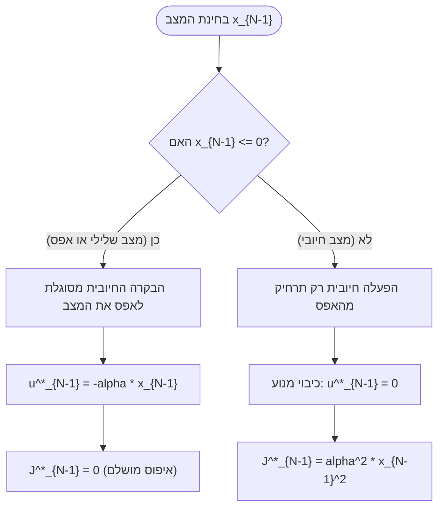
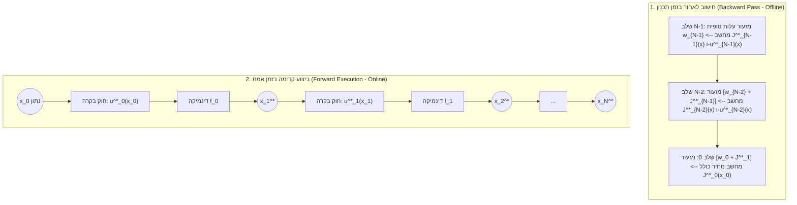

# חוברת העמקה והסברים פדגוגיים – הרצאה 2: תכנות דינמי ובקר LQR

> **קורס:** בקרה אופטימלית  
> **מבוסס על:** סיכום לוח מלא – הרצאה 2 (`סיכום_לוח_הרצאה_2.md`, קובץ וידאו `הרצאה 2.mp4`)  
> **מטרה לימודית:** פירוק מושגי היסוד של תכנות דינמי (Dynamic Programming), טיפול באילוצי מפעיל חד-כיווניים, הבנת משוואת בלמן הכללית וגזירה שלמה של בקר LQR (Linear Quadratic Regulator) בזמן בדיד תוך השוואת חוג פתוח מול חוג סגור.

---

## תוכן עניינים
1. [פרק 1: אופטימיזציה תחת אילוצי מפעיל – בקרת דחף חד-כיוונית](#פרק-1-אופטימיזציה-תחת-אילוצי-מפעיל--בקרת-דחף-חד-כיוונית)
   * 1.1 מוטיבציה הנדסית: מפעילים חד-כיווניים בעולם האמיתי
   * 1.2 מילון מונחים, סימונים וטכניקת המשתנה הריבועי
   * 1.3 פתרון השלב האחרון: ניתוח קבילות פיזיקלית (Feasibility Analysis)
   * 1.4 מעבר לשלבים מוקדמים ותרשים החלטה
2. [פרק 2: תהליך החלטה רב-שלבי (MSDP) ומשוואת בלמן הכללית](#פרק-2-תהליך-החלטה-רב-שלבי-msdp-ומשוואת-בלמן-הכללית)
   * 2.1 מרכיבי המודל הכללי בזמן בדיד
   * 2.2 עקרון האופטימליות של בלמן ופונקציית העלות להמשך (Cost-to-Go)
   * 2.3 ארכיטקטורת הפתרון: חישוב לאחור (Backward Pass) מול מימוש קדימה (Forward Pass)
3. [פרק 3: בקר לינארי ריבועי בזמן בדיד (Discrete-Time LQR)](#פרק-3-בקר-לינארי-ריבועי-בזמן-בדיד-discrete-time-lqr)
   * 3.1 מדוע בעיית LQR היא אבן הראשה של הבקרה האופטימלית?
   * 3.2 פירוק פונקציית המחיר הריבועית: האיזון ההנדסי (Trade-off)
   * 3.3 גזירה שלב-אחר-שלב של הדוגמה מההרצאה ($N=3$)
   * 3.4 ניתוח השתנות הגברי המשוב לאורך הזמן
4. [פרק 4: אימות גלובלי – חוג פתוח (Open-Loop) לעומת חוג סגור (Closed-Loop)](#פרק-4-אימות-גלובלי--חוג-פתוח-open-loop-לעומת-חוג-סגור-closed-loop)
   * 4.1 פתרון הבעיה כבעיית אופטימיזציה גלובלית רב-משתנית
   * 4.2 הדגמה מספרית מלאה וסימולציה קדימה
   * 4.3 היתרון הקריטי של משוב מצב מול רעשים והפרעות
5. [פרק 5: דגשים למבחן, תובנות מפתח ומלכודות נפוצות](#פרק-5-דגשים-למבחן-תובנות-מפתח-ומלכודות-נפוצות)

---

## פרק 1: אופטימיזציה תחת אילוצי מפעיל – בקרת דחף חד-כיוונית

### 1.1 מוטיבציה הנדסית: מפעילים חד-כיווניים בעולם האמיתי

בבעיות בקרה קלאסיות מניחים פעמים רבות שמרחב הבקרה אינו מוגבל, כלומר אות הבקרה $u$ יכול לקבל כל ערך ממשי:

$$u \in \mathbb{R}$$

אולם במערכות פיזיקליות והנדסיות אמיתיות, כמעט כל מפעיל (Actuator) כפוף למגבלות פיזיקליות קשיחות. מקרה נפוץ במיוחד הוא **מפעיל חד-כיווני (Unidirectional Actuator)**:
* **מנוע רקטי / מדחפי גז קר בלוויין:** רקטה יכולה לפלוט גז וליצור כוח דחף קדימה ($u \ge 0$), אך אינה יכולה "לשאוב" גז כדי למשוך את הרקטה לאחור.
* **מערכת בלמים ברכב:** הבלם מפעיל מומנט חיכוך המאט את הגלגלים ($u \ge 0$), אך אינו יכול להאיץ אותם קדימה.
* **ברז מילוי במכל כימי:** הברז יכול להזרים נוזל פנימה בקצב חיובי ($u \ge 0$), אך אינו יכול לרוקן את המכל.

כאשר קיים אילוץ אי-שליליות כזה, הכלים החדו"איים הרגילים (איפוס נגזרת פשוט) עלולים להניב פתרון בלתי אפשרי למימוש (ערך שלילי לבקרה).

---

### 1.2 מילון מונחים, סימונים וטכניקת המשתנה הריבועי

ההרצאה פותחת במודל סקלרי פשוט בזמן בדיד:

$$x_{k+1} = \alpha x_k + u_k$$

כאשר:
* $x_k \in \mathbb{R}$ – מצב המערכת בזמן $k$ (למשל: מהירות הרכב או שגיאת המיקום של הרחפן).
* $u_k \in \mathbb{R}$ – אות הבקרה המופעל בזמן $k$ (למשל: כוח הדחף).
* $\alpha \in \mathbb{R}$ – פרמטר הדינמיקה הטבעית של המערכת (התנהגות המערכת ללא בקרה). נניח $\alpha > 0$.
* $J = \sum_{k=0}^{N-1} x_{k+1}^2$ – פונקציית מחיר המודדת את ריבוע הסטייה של המצב מאפס לאורך כל מסלול התנועה. שימו לב: בדוגמה זו אין קנס על אנרגיית הבקרה ($u_k$), אלא רק דרישה להביא את המצב לאפס.
* $u_k \ge 0$ – אילוץ אי-שליליות לכל שלב $k$.

> [!TIP]
> **הטכניקה האלגברית שנלמדה על הלוח:**  
> כדי להימנע מפתרון תנאי KKT מורכבים (Karush-Kuhn-Tucker) או מכפלי לגראנז' עם אי-שוויונות, מבצעים החלפת משתנים:
> 
> $$u_k \equiv \hat{u}_k^2, \qquad \hat{u}_k \in \mathbb{R}$$
> 
> מכיוון שריבוע של כל מספר ממשי הוא אי-שלילי ($\hat{u}_k^2 \ge 0$), כל בחירה של $\hat{u}_k$ תספק אוטומטית את האילוץ המקורי, והבעיה הופכת לבעיית אופטימיזציה חופשית ללא אילוצים במשתנה $\hat{u}_k$!

משוואת הדינמיקה מנוסחת מחדש כך:

$$x_{k+1} = \alpha x_k + \hat{u}_k^2$$

---

### 1.3 פתרון השלב האחרון: ניתוח קבילות פיזיקלית (Feasibility Analysis)

על פי עקרון התכנות הדינמי, מתחילים לפתור מהצעד האחרון ($k = N-1$):

$$J_{N-1} = x_N^2 = (\alpha x_{N-1} + \hat{u}_{N-1}^2)^2$$

נחפש נקודות שבהן הנגזרת מתאפסת:

$$\frac{\partial J_{N-1}}{\partial \hat{u}_{N-1}} = 2 (\alpha x_{N-1} + \hat{u}_{N-1}^2) \cdot 2\hat{u}_{N-1} = 4 \hat{u}_{N-1} (\alpha x_{N-1} + \hat{u}_{N-1}^2) = 0$$

למשוואה זו יש שני גורמים שיכולים להתאפס בנפרד:

1. **איפוס הגורם הראשון:** $\hat{u}_{N-1} = 0$.  
   משמעות הדבר:
   
$$u_{N-1} = 0, \qquad x_N = \alpha x_{N-1}, \qquad J_{N-1} = \alpha^2 x_{N-1}^2$$

2. **איפוס הגורם בסוגריים:** $\alpha x_{N-1} + \hat{u}_{N-1}^2 = 0$.  
   משמעות הדבר:
   
$$\hat{u}_{N-1}^2 = -\alpha x_{N-1} \implies u_{N-1} = -\alpha x_{N-1}, \qquad x_N = 0, \qquad J_{N-1} = 0$$

כעת מגיע הניתוח ההנדסי החשוב ביותר – **בדיקת קבילות בממשיים**:

* **תרחיש א': המצב הנוכחי הוא שלילי ($x_{N-1} \le 0$)**  
  מכיוון ש-$\alpha > 0$, הביטוי $-\alpha x_{N-1}$ הוא חיובי או אפס.  
  לכן קיים פתרון ממשי $\hat{u}_{N-1} = \sqrt{-\alpha x_{N-1}}$, ואות הבקרה הוא חיובי וקביל לחלוטין:
  
$$u_{N-1}^* = -\alpha x_{N-1} \ge 0$$
  
  במקרה זה, המנוע החד-כיווני מסוגל לדחוף בדיוק בעוצמה הנדרשת כדי לבטל את השגיאה, ומביא את המערכת בדיוק למצב היעד:
  
$$x_N = \alpha x_{N-1} + (-\alpha x_{N-1}) = 0 \implies J_{N-1}^* = 0$$

* **תרחיש ב': המצב הנוכחי הוא חיובי ($x_{N-1} > 0$)**  
  כאן $-\alpha x_{N-1} < 0$.  
  מכיוון ש-$\hat{u}_{N-1}^2$ אינו יכול להיות שלילי עבור שום מספר ממשי, הפתרון השני **אינו קיים במרחב הפיזיקלי**.  
  הפתרון הקביל היחיד הוא הפתרון הראשון:
  
$$u_{N-1}^* = 0$$
  
  המחיר שנותר הוא מחיר הסטייה הטבעית של המערכת:
  
$$J_{N-1}^* = \alpha^2 x_{N-1}^2$$

> [!NOTE]
> **הסבר אינטואיטיבי מהעולם האמיתי:**  
> אם המערכת כבר נמצאת מעל היעד ($x_{N-1} > 0$), והמנוע יכול רק להוסיף כוח חיובי שיגדיל עוד יותר את המרחק מהיעד, הדבר החכם ביותר שהבקר יכול לעשות הוא **לכבות את המנוע לחלוטין ($u=0$)**. כל הפעלה של הבקרה רק תחמיר את השגיאה!

---

### 1.4 מעבר לשלבים מוקדמים ותרשים החלטה

בשכבה הבאה ($k = N-2$), פונקציית המחיר הופכת למפוצלת (Piecewise Function):

$$J_{N-2} = x_{N-1}^2 + J_{N-1}^*(x_{N-1})$$

כאשר:

$$J_{N-1}^*(x_{N-1}) = \begin{cases} 0 & x_{N-1} \le 0 \\ \alpha^2 x_{N-1}^2 & x_{N-1} > 0 \end{cases}$$

נציב את הדינמיקה $x_{N-1} = \alpha x_{N-2} + u_{N-2}$:
* אם $x_{N-1} \le 0$, המחיר הוא רק $x_{N-1}^2$ (כי העלות להמשך היא 0).
* אם $x_{N-1} > 0$, המחיר הוא $(1 + \alpha^2) x_{N-1}^2$.

תרשים הזרימה של קבלת ההחלטה בשלב האחרון מוצג להלן:

---

## פרק 2: תהליך החלטה רב-שלבי (MSDP) ומשוואת בלמן הכללית

### 2.1 מרכיבי המודל הכללי בזמן בדיד

בסעיף A.1.3 בהרצאה הוצגה המסגרת המתמטית השלמה של **תהליך החלטה מרקובי רב-שלבי (Multi-Stage Decision Process)**:

1. **משוואת מעבר המצב (State Dynamics):**
   
$$\underline{x}_{k+1} = \underline{f}_k(\underline{x}_k, \underline{u}_k)$$
   
   * $\underline{x}_k \in \mathbb{R}^n$ – וקטור המצב בממד $n$. הקו התחתי $\underline{x}$ מדגיש שמדובר בווקטור ולא בסקלר.
   * $\underline{u}_k \in \mathbb{R}^m$ – וקטור הבקרה בממד $m$.
   * $\underline{f}_k: \mathbb{R}^n \times \mathbb{R}^m \to \mathbb{R}^n$ – פונקציית הדינמיקה הממפה את המצב והבקרה הנוכחיים למצב הבא.

2. **עלות השלב (Stage Cost / Running Cost):**
   
$$w_k(\underline{x}_{k+1}, \underline{u}_k) \ge 0$$
   
   העלות הנצברת במעבר בודד משלב $k$ לשלב $k+1$. עלות זו מודדת הן את איכות הביצועים (קרבה ליעד) והן את מאמץ הבקרה שהושקע בצעד זה.

3. **פונקציית המחיר המצטבר (Total Cost Functional):**
   
$$J_K = \sum_{k=K}^{N-1} w_k(\underline{x}_{k+1}, \underline{u}_k)$$
   
   סך כל העלויות הנצברות החל משלב $K$ ועד סוף האופק בזמן $N-1$.

---

### 2.2 עקרון האופטימליות של בלמן ופונקציית העלות להמשך (Cost-to-Go)

ריצ'רד בלמן (Richard Bellman, 1957) ניסח את עקרון האופטימליות העומד בבסיס התכנות הדינמי:

> [!IMPORTANT]
> **עקרון האופטימליות של בלמן:**  
> "מדיניות בקרה אופטימלית מתאפיינת בכך שלכל מצב התחלתי ולהחלטה התחלתית שנבחרה, ההחלטות הנותרות חייבות להוות מדיניות אופטימלית ביחס למצב שנוצר כתוצאה מההחלטה הראשונה."

במילים פשוטות: **אין "חרטות" בתכנות דינמי.** לא משנה כיצד המערכת הגיעה למצב מסוים $\underline{x}_k$, מרגע זה ועד סוף התהליך עלינו לבחור את המסלול המיטבי ביותר האפשרי מאותה נקודה והלאה.

מכאן נגזרת **משוואת בלמן בזמן בדיד**:

$$J_k^*(\underline{x}_k) = \min_{\underline{u}_k} \Big[ w_k\big(\underline{f}_k(\underline{x}_k, \underline{u}_k), \underline{u}_k\big) + J_{k+1}^*\big(\underline{f}_k(\underline{x}_k, \underline{u}_k)\big) \Big]$$

שני התוצרים המרכזיים של פתרון המשוואה בכל שלב $k$:
1. **פונקציית העלות האופטימלית להמשך ($J_k^*(\underline{x}_k)$, Optimal Value / Cost-to-Go Function):**  
   פונקציה המקבלת מצב $\underline{x}_k$ ומחזירה סקלר המייצג את המחיר המינימלי המובטח מהשלב הנוכחי ועד סוף האופק.
2. **חוק הבקרה האופטימלי במדיניות משוב ($\underline{u}_k^*(\underline{x}_k)$, Optimal State Feedback Policy):**  
   כלל פעולה (Function) המורה לבקר איזה אות להפעיל לכל מצב שיימדד בפועל.

---

### 2.3 ארכיטקטורת הפתרון: חישוב לאחור (Backward Pass) מול מימוש קדימה (Forward Pass)

מדוע פותרים לאחור אך מפעילים קדימה?
* **בשלב החישוב (Backward Pass – Offline):**  
  איננו יודעים מראש היכן תימצא המערכת בשלב $k$, מכיוון שהדבר תלוי בכל הבקרות הקודמות. לכן פותרים לאחור מהסוף ($k = N-1$) להתחלה ($k = 0$), ומפיקים לכל שלב פונקציית החלטה שתקפה ל**כל מצב אפשרי**.
* **בשלב המימוש (Forward Pass – Online):**  
  בזמן אמת המערכת מתחילה במצב התחלתי נתון $\underline{x}_0$. מזינים אותו לחוק הבקרה $\underline{u}_0^*(\underline{x}_0)$, המערכת מתקדמת למצב $\underline{x}_1$, ומשם ממשיכים צעד אחר צעד עד סוף המסלול.

---

## פרק 3: בקר לינארי ריבועי בזמן בדיד (Discrete-Time LQR)

### 3.1 מדוע בעיית LQR היא אבן הראשה של הבקרה האופטימלית?

משפחת בעיות **Linear-Quadratic Regulator (LQR)** מהווה את הבסיס המרכזי לתורת הבקרה המודרנית בזכות שלושה מאפיינים ייחודיים:
1. **קירוב אוניברסלי:** כל מערכת לא-לינארית חלקה ניתנת ללינאריזציה סביב נקודת עבודה ($\dot{x} \approx Ax + Bu$).
2. **פתרון אנליטי סגור:** בניגוד לרוב בעיות הבקרה האופטימלית שדורשות שיטות נומריות כבדות, ל-LQR יש פתרון אנליטי מדויק בצורת משוב מצב לינארי:
   
$$\underline{u}_k^* = -K_k \underline{x}_k$$
   
3. **יציבות וחוסן (Robustness):** למשוב LQR יש שולי יציבות (Gain/Phase Margins) מעולים ותכונות ריסון מוכחות מתמטית.

---

### 3.2 פירוק פונקציית המחיר הריבועית: האיזון ההנדסי (Trade-off)

הבעיה מוגדרת כך:

$$\underline{x}_{k+1} = A \underline{x}_k + B \underline{u}_k$$

$$J = \sum_{k=0}^{N-1} \Big( \|\underline{x}_{k+1}\|_Q^2 + \|\underline{u}_k\|_R^2 \Big)$$

כאשר הנורמה המטריציאנית המשוקללת מוגדרת ע"י:

$$\|\underline{z}\|_M^2 \equiv \underline{z}^T M \underline{z}$$

#### משמעות המשקולות והאיזון ההנדסי:
* **איבר הסטייה $\|\underline{x}_{k+1}\|_Q^2$:**  
  מודד את אי-הדיוק של המערכת ביחס לאפס. המטריצה $Q$ חייבת להיות **חיובית חצי-מוגדרת ($Q \ge 0$)** וסימטרית. אם נגדיל את ערכי $Q$, הבקר ישאף למשוך את המצב לאפס במהירות ובתוקפנות רבה.
* **איבר המאמץ $\|\underline{u}_k\|_R^2$:**  
  מודד את מחיר הבקרה (אנרגיה חשמלית של המנוע, צריכת דלק, בלאי מכני של מפעילים). המטריצה $R$ חייבת להיות **חיובית מוגדרת בהחלט ($R > 0$)**.

> [!CAUTION]
> **מדוע $R$ חייבת להיות חיובית ממש ($R > 0$) ולא רק חיובית חצי-מוגדרת ($R \ge 0$)?**  
> אם $R$ הייתה מתאפסת או לא מוגדרת בהחלט, פירוש הדבר היה ש"הבקרה ניתנת בחינם". במצב כזה, כדי לאפס את השגיאה, הבקר היה מפעיל אות בקרה אינסופי בצעד אחד ($u \to \infty$, Singular Control / Deadbeat), דבר שיוביל לרוויה, כשל מנוע או שבירה פיזיקלית של המערכת!

---

### 3.3 גזירה שלב-אחר-שלב של הדוגמה מההרצאה ($N=3$)

נתוני המערכת שנפתרה בפירוט מוחלט על הלוח:
* מרחב המצב: ממד $n = 2$, כלומר $\underline{x}_k = \begin{bmatrix} x_{k,1} \\ x_{k,2} \end{bmatrix}$.
* אות הבקרה: סקלר $u_k \in \mathbb{R}$ ($m = 1$).
* מטריצות הדינמיקה:
  
$$A = I_2 = \begin{bmatrix} 1 & 0 \\ 0 & 1 \end{bmatrix}, \qquad \underline{b} = \begin{bmatrix} 1 \\ 1 \end{bmatrix}$$
  
  כלומר משוואת המעבר היא:
  
$$\underline{x}_{k+1} = \underline{x}_k + \underline{b} u_k$$
  
* משקולות המחיר: $Q = I_2$ ו-$R = 1$.  
  לכן $\|\underline{x}_{k+1}\|_Q^2 = \|\underline{x}_{k+1}\|^2$ ו-$\|u_k\|_R^2 = u_k^2$.
* אופק הזמן: $N = 3$, כלומר שלבים $k = 0, 1, 2$.

---

#### שלב אחרון: $k = 2$

העלות של הצעד האחרון היא:

$$J_2 = \|\underline{x}_3\|^2 + u_2^2$$

נציב את הדינמיקה $\underline{x}_3 = \underline{x}_2 + \underline{b} u_2$:

$$J_2 = \|\underline{x}_2 + \underline{b} u_2\|^2 + u_2^2$$

נפתח את המכפלה הסקלרית של הנורמה:

$$\|\underline{x}_2 + \underline{b} u_2\|^2 = (\underline{x}_2 + \underline{b} u_2)^T (\underline{x}_2 + \underline{b} u_2) = \|\underline{x}_2\|^2 + 2 u_2 \underline{b}^T \underline{x}_2 + u_2^2 \|\underline{b}\|^2$$

מכיוון ש-$\underline{b} = \begin{bmatrix} 1 \\ 1 \end{bmatrix}$, נחשב את הנורמה שלו:

$$\|\underline{b}\|^2 = 1^2 + 1^2 = 2$$

נציב חזרה ב-$J_2$:

$$J_2 = \|\underline{x}_2\|^2 + 2 u_2 \underline{b}^T \underline{x}_2 + u_2^2 (2 + 1) = \|\underline{x}_2\|^2 + 2 u_2 \underline{b}^T \underline{x}_2 + 3 u_2^2$$

נגזור לפי $u_2$ ונשווה לאפס:

$$\frac{\partial J_2}{\partial u_2} = 2 \underline{b}^T \underline{x}_2 + 6 u_2 = 0$$

ומכאן נקבל את חוק הבקרה האופטימלי לשלב 2:

$$u_2^*(\underline{x}_2) = -\frac{1}{3} \underline{b}^T \underline{x}_2$$

נציב את $u_2^*$ בחזרה לביטוי של $J_2$ כדי לקבל את פונקציית העלות להמשך $J_2^*(\underline{x}_2)$:

$$J_2^*(\underline{x}_2) = \|\underline{x}_2\|^2 + 2 \left(-\frac{1}{3}\underline{b}^T\underline{x}_2\right)\underline{b}^T\underline{x}_2 + 3 \left(-\frac{1}{3}\underline{b}^T\underline{x}_2\right)^2$$

$$J_2^*(\underline{x}_2) = \|\underline{x}_2\|^2 - \frac{2}{3}(\underline{b}^T\underline{x}_2)^2 + \frac{1}{3}(\underline{b}^T\underline{x}_2)^2$$

$$J_2^*(\underline{x}_2) = \|\underline{x}_2\|^2 - \frac{1}{3}(\underline{b}^T\underline{x}_2)^2$$

---

#### שלב לפני אחרון: $k = 1$

על פי משוואת בלמן, המחיר הנצבר החל משלב 1 הוא עלות הצעד הנוכחי ועוד פונקציית העלות האופטימלית להמשך משלב 2:

$$J_1 = \|\underline{x}_2\|^2 + u_1^2 + J_2^*(\underline{x}_2)$$

נציב את הביטוי שמצאנו עבור $J_2^*(\underline{x}_2)$:

$$J_1 = \|\underline{x}_2\|^2 + u_1^2 + \|\underline{x}_2\|^2 - \frac{1}{3}(\underline{b}^T\underline{x}_2)^2 = 2\|\underline{x}_2\|^2 - \frac{1}{3}(\underline{b}^T\underline{x}_2)^2 + u_1^2$$

כעת נבטא את כל האיברים התלויים ב-$\underline{x}_2$ בעזרת המצב הקודם $\underline{x}_1$ והבקרה $u_1$:
* $\|\underline{x}_2\|^2 = \|\underline{x}_1 + \underline{b} u_1\|^2 = \|\underline{x}_1\|^2 + 2 u_1 \underline{b}^T \underline{x}_1 + 2 u_1^2$
* $\underline{b}^T \underline{x}_2 = \underline{b}^T (\underline{x}_1 + \underline{b} u_1) = \underline{b}^T \underline{x}_1 + \|\underline{b}\|^2 u_1 = \underline{b}^T \underline{x}_1 + 2 u_1$
* ריבוע הביטוי: $(\underline{b}^T \underline{x}_2)^2 = (\underline{b}^T \underline{x}_1)^2 + 4 u_1 \underline{b}^T \underline{x}_1 + 4 u_1^2$

נציב הכל בחזרה לתוך $J_1$:

$$J_1 = 2 \Big[ \|\underline{x}_1\|^2 + 2 u_1 \underline{b}^T \underline{x}_1 + 2 u_1^2 \Big] - \frac{1}{3} \Big[ (\underline{b}^T \underline{x}_1)^2 + 4 u_1 \underline{b}^T \underline{x}_1 + 4 u_1^2 \Big] + u_1^2$$

נכנס איברים דומים לפי חזקות של $u_1$:
* איבר חופשי מ-$u_1$: $2\|\underline{x}_1\|^2 - \frac{1}{3}(\underline{b}^T\underline{x}_1)^2$
* מקדם של $u_1$: $\left(4 - \frac{4}{3}\right) \underline{b}^T \underline{x}_1 = \frac{8}{3} \underline{b}^T \underline{x}_1$
* מקדם של $u_1^2$: $2 \cdot 2 - \frac{4}{3} + 1 = 4 - \frac{4}{3} + 1 = 5 - \frac{4}{3} = \frac{11}{3}$

מתקבל:

$$J_1 = 2\|\underline{x}_1\|^2 - \frac{1}{3}(\underline{b}^T\underline{x}_1)^2 + \frac{8}{3} u_1 \underline{b}^T \underline{x}_1 + \frac{11}{3} u_1^2$$

נגזור לפי $u_1$ ונשווה לאפס:

$$\frac{\partial J_1}{\partial u_1} = \frac{8}{3} \underline{b}^T \underline{x}_1 + \frac{22}{3} u_1 = 0$$

ומכאן:

$$u_1^*(\underline{x}_1) = -\frac{8/3}{22/3} \underline{b}^T \underline{x}_1 = -\frac{4}{11} \underline{b}^T \underline{x}_1$$

נציב את $u_1^*$ חזרה כדי לחשב את $J_1^*(\underline{x}_1)$:

$$J_1^*(\underline{x}_1) = 2\|\underline{x}_1\|^2 - \frac{1}{3}(\underline{b}^T\underline{x}_1)^2 + \frac{8}{3}\left(-\frac{4}{11}\underline{b}^T\underline{x}_1\right)\underline{b}^T\underline{x}_1 + \frac{11}{3}\left(-\frac{4}{11}\underline{b}^T\underline{x}_1\right)^2$$

$$J_1^*(\underline{x}_1) = 2\|\underline{x}_1\|^2 + (\underline{b}^T\underline{x}_1)^2 \left( -\frac{1}{3} - \frac{32}{33} + \frac{16}{33} \right) = 2\|\underline{x}_1\|^2 + (\underline{b}^T\underline{x}_1)^2 \left( -\frac{11}{33} - \frac{16}{33} \right)$$

$$J_1^*(\underline{x}_1) = 2\|\underline{x}_1\|^2 - \frac{27}{33}(\underline{b}^T\underline{x}_1)^2 = 2\|\underline{x}_1\|^2 - \frac{9}{11}(\underline{b}^T\underline{x}_1)^2$$

---

#### שלב ראשון: $k = 0$

בשלב ההתחלתי:

$$J_0 = \|\underline{x}_1\|^2 + u_0^2 + J_1^*(\underline{x}_1)$$

נציב את $J_1^*$:

$$J_0 = \|\underline{x}_1\|^2 + u_0^2 + 2\|\underline{x}_1\|^2 - \frac{9}{11}(\underline{b}^T\underline{x}_1)^2 = 3\|\underline{x}_1\|^2 - \frac{9}{11}(\underline{b}^T\underline{x}_1)^2 + u_0^2$$

נפתח בעזרת $\underline{x}_1 = \underline{x}_0 + \underline{b} u_0$:
* $\|\underline{x}_1\|^2 = \|\underline{x}_0\|^2 + 2 u_0 \underline{b}^T \underline{x}_0 + 2 u_0^2$
* $(\underline{b}^T \underline{x}_1)^2 = (\underline{b}^T \underline{x}_0)^2 + 4 u_0 \underline{b}^T \underline{x}_0 + 4 u_0^2$

נציב לתוך $J_0$:

$$J_0 = 3 \Big[ \|\underline{x}_0\|^2 + 2 u_0 \underline{b}^T \underline{x}_0 + 2 u_0^2 \Big] - \frac{9}{11} \Big[ (\underline{b}^T \underline{x}_0)^2 + 4 u_0 \underline{b}^T \underline{x}_0 + 4 u_0^2 \Big] + u_0^2$$

נכנס איברים:
* איבר חופשי: $3\|\underline{x}_0\|^2 - \frac{9}{11}(\underline{b}^T\underline{x}_0)^2$
* מקדם של $u_0$: $\left(6 - \frac{36}{11}\right)\underline{b}^T\underline{x}_0 = \frac{30}{11}\underline{b}^T\underline{x}_0$
* מקדם של $u_0^2$: $3 \cdot 2 - \frac{36}{11} + 1 = 7 - \frac{36}{11} = \frac{41}{11}$

מתקבל:

$$J_0 = 3\|\underline{x}_0\|^2 - \frac{9}{11}(\underline{b}^T\underline{x}_0)^2 + \frac{30}{11} u_0 \underline{b}^T \underline{x}_0 + \frac{41}{11} u_0^2$$

נגזור לפי $u_0$ ונשווה לאפס:

$$\frac{\partial J_0}{\partial u_0} = \frac{30}{11}\underline{b}^T\underline{x}_0 + \frac{82}{11} u_0 = 0$$

ומכאן נקבל את חוק הבקרה לשלב הראשון:

$$u_0^*(\underline{x}_0) = -\frac{30}{82}\underline{b}^T\underline{x}_0 = -\frac{15}{41}\underline{b}^T\underline{x}_0$$

נציב את $u_0^*$ לתוך $J_0$ לקבלת המחיר האופטימלי הגלובלי:

$$J_0^*(\underline{x}_0) = 3\|\underline{x}_0\|^2 - \frac{9}{11}(\underline{b}^T\underline{x}_0)^2 + \frac{30}{11}\left(-\frac{15}{41}\underline{b}^T\underline{x}_0\right)\underline{b}^T\underline{x}_0 + \frac{41}{11}\left(-\frac{15}{41}\underline{b}^T\underline{x}_0\right)^2$$

$$J_0^*(\underline{x}_0) = 3\|\underline{x}_0\|^2 + (\underline{b}^T\underline{x}_0)^2 \left( -\frac{9}{11} - \frac{450}{11 \cdot 41} + \frac{225}{11 \cdot 41} \right) = 3\|\underline{x}_0\|^2 - (\underline{b}^T\underline{x}_0)^2 \left( \frac{9 \cdot 41 + 225}{451} \right)$$

$$\frac{9 \cdot 41 + 225}{451} = \frac{369 + 225}{451} = \frac{594}{451} = \frac{54}{41}$$

ומכאן:

$$J_0^*(\underline{x}_0) = 3\|\underline{x}_0\|^2 - \frac{54}{41}(\underline{b}^T\underline{x}_0)^2$$

---

### 3.4 ניתוח השתנות הגברי המשוב לאורך הזמן

נסכם את שלישיית חוקי הבקרה האופטימליים שקיבלנו:

$$\begin{cases}

u_0^*(\underline{x}_0) = -K_0 \underline{x}_0 = -\dfrac{15}{41} \underline{b}^T \underline{x}_0 \approx -0.3658 \, \underline{b}^T \underline{x}_0 \\[10pt]
u_1^*(\underline{x}_1) = -K_1 \underline{x}_1 = -\dfrac{4}{11} \underline{b}^T \underline{x}_1 \approx -0.3636 \, \underline{b}^T \underline{x}_1 \\[10pt]
u_2^*(\underline{x}_2) = -K_2 \underline{x}_2 = -\dfrac{1}{3} \underline{b}^T \underline{x}_2 \approx -0.3333 \, \underline{b}^T \underline{x}_2

\end{cases}$$

> [!NOTE]
> **מדוע הגבר המשוב יורד ככל שמתקרבים לסוף האופק?**  
> * בשלב $k = 0$, להחלטת הבקרה יש השפעה מתגלגלת לאורך כל 3 השלבים הבאים ($x_1, x_2, x_3$). לכן כדאי להשקיע מאמץ בקרה יחסית גבוה ($\frac{15}{41}$) כבר בהתחלה כדי להקטין את השגיאה שתשפיע על כל השלבים הבאים.
> * לעומת זאת, בשלב האחרון $k = 2$, לבקרה יש השפעה רק על צעד בודד אחד ($x_3$). אין עוד שלבים עתידיים שירוויחו מהקטנת השגיאה, ולכן ההגבר האופטימלי יורד ל-$\frac{1}{3}$.  
> זוהי תופעה קלאסית בבקרי LQR סופיים בזמן (Finite Horizon LQR): הגבר המשוב $K_k$ משתנה בזמן (Time-Varying Gain) ודועך לקראת סוף האופק.

---

## פרק 4: אימות גלובלי – חוג פתוח (Open-Loop) לעומת חוג סגור (Closed-Loop)

### 4.1 פתרון הבעיה כבעיית אופטימיזציה גלובלית רב-משתנית

כדי להוכיח את נכונות התוצאה, נפתור כעת את אותה הבעיה ללא תכנות דינמי, אלא כבעיית מזעור אחת גלובלית בחדו"א של 3 משתנים בלתי תלויים: $(u_0, u_1, u_2)$.

נביע את כל המצבים העתידיים כפונקציה של המצב ההתחלתי $\underline{x}_0$ וסדרת הבקרות:

$$\underline{x}_1 = \underline{x}_0 + \underline{b} u_0$$

$$\underline{x}_2 = \underline{x}_1 + \underline{b} u_1 = \underline{x}_0 + \underline{b} u_0 + \underline{b} u_1 = \underline{x}_0 + \underline{b} (u_0 + u_1)$$

$$\underline{x}_3 = \underline{x}_2 + \underline{b} u_2 = \underline{x}_0 + \underline{b} (u_0 + u_1 + u_2)$$

פונקציית המחיר הגלובלית:

$$J(u_0, u_1, u_2) = \|\underline{x}_1\|^2 + u_0^2 + \|\underline{x}_2\|^2 + u_1^2 + \|\underline{x}_3\|^2 + u_2^2$$

$$J = \|\underline{x}_0 + \underline{b} u_0\|^2 + u_0^2 + \|\underline{x}_0 + \underline{b}(u_0 + u_1)\|^2 + u_1^2 + \|\underline{x}_0 + \underline{b}(u_0 + u_1 + u_2)\|^2 + u_2^2$$

נגדיר את הסקלר $S \equiv -\underline{b}^T \underline{x}_0$.  
נפתח ונגזור חלקית לפי כל אחד משלושת המשתנים $\frac{\partial J}{\partial u_i} = 0$:

1. נגזרת לפי $u_2$:  
   מופיע רק באיבר של $\underline{x}_3$ וב-$u_2^2$:
   
$$\frac{\partial J}{\partial u_2} = 2 \underline{b}^T [\underline{x}_0 + \underline{b}(u_0 + u_1 + u_2)] + 2 u_2 = 0$$
   
   נחלק ב-2 ונציב $\|\underline{b}\|^2 = 2$:
   
$$\underline{b}^T \underline{x}_0 + 2(u_0 + u_1 + u_2) + u_2 = 0 \implies 2 u_0 + 2 u_1 + 3 u_2 = -\underline{b}^T \underline{x}_0 = S$$

2. נגזרת לפי $u_1$:  
   מופיע באיברים של $\underline{x}_2, \underline{x}_3$ וב-$u_1^2$:
   
$$\frac{\partial J}{\partial u_1} = 2 \underline{b}^T [\underline{x}_0 + \underline{b}(u_0 + u_1)] + 2 \underline{b}^T [\underline{x}_0 + \underline{b}(u_0 + u_1 + u_2)] + 2 u_1 = 0$$
   
$$2 \underline{b}^T \underline{x}_0 + 2(2 u_0 + 2 u_1) + 2 u_2 + u_1 = 0 \implies 4 u_0 + 5 u_1 + 2 u_2 = -2 \underline{b}^T \underline{x}_0 = 2S$$

3. נגזרת לפי $u_0$:  
   מופיע בכל שלושת המצבים $\underline{x}_1, \underline{x}_2, \underline{x}_3$ וב-$u_0^2$:
   
$$\frac{\partial J}{\partial u_0} = 2 \underline{b}^T \underline{x}_1 + 2 \underline{b}^T \underline{x}_2 + 2 \underline{b}^T \underline{x}_3 + 2 u_0 = 0$$
   
$$3 \underline{b}^T \underline{x}_0 + 2(3 u_0 + 2 u_1 + u_2) + u_0 = 0 \implies 7 u_0 + 4 u_1 + 2 u_2 = -3 \underline{b}^T \underline{x}_0 = 3S$$

הגענו למערכת משוואות לינאריות סימטרית ומוגדרת חיובית:

$$\begin{bmatrix} 7 & 4 & 2 \\ 4 & 5 & 2 \\ 2 & 2 & 3 \end{bmatrix} \begin{bmatrix} u_0 \\ u_1 \\ u_2 \end{bmatrix} = \begin{bmatrix} 3 \\ 2 \\ 1 \end{bmatrix} S$$

נחשב את הדטרמיננטה של מטריצת המקדמים $M$:

$$\det(M) = 7(15 - 4) - 4(12 - 4) + 2(8 - 10) = 7(11) - 4(8) + 2(-2) = 77 - 32 - 4 = 41$$

פתרון המערכת בעזרת כלל קרמר (או הפיכת מטריצה):

$$\begin{bmatrix} u_0^* \\ u_1^* \\ u_2^* \end{bmatrix} = \frac{1}{41} \begin{bmatrix} 11 & -8 & -2 \\ -8 & 17 & -6 \\ -2 & -6 & 19 \end{bmatrix} \begin{bmatrix} 3 \\ 2 \\ 1 \end{bmatrix} S = \frac{1}{41} \begin{bmatrix} 33 - 16 - 2 \\ -24 + 34 - 6 \\ -6 - 12 + 19 \end{bmatrix} S = \begin{bmatrix} \dfrac{15}{41} S \\[8pt] \dfrac{4}{41} S \\[8pt] \dfrac{1}{41} S \end{bmatrix}$$

קיבלנו את אותות הבקרה האופטימליים בחוג פתוח:

$$\boxed{u_0^* = -\frac{15}{41} \underline{b}^T \underline{x}_0, \qquad u_1^* = -\frac{4}{41} \underline{b}^T \underline{x}_0, \qquad u_2^* = -\frac{1}{41} \underline{b}^T \underline{x}_0}$$

---

### 4.2 הדגמה מספרית מלאה וסימולציה קדימה

נשתמש בנתוני הדוגמה המספרית שהמרצה הציג על הלוח:

$$\underline{x}_0 = \begin{bmatrix} 20 \\ 21 \end{bmatrix}, \qquad \underline{b} = \begin{bmatrix} 1 \\ 1 \end{bmatrix}$$

חישובים התחלתיים:

$$\underline{b}^T \underline{x}_0 = 1 \cdot 20 + 1 \cdot 21 = 41$$

$$\|\underline{x}_0\|^2 = 20^2 + 21^2 = 400 + 441 = 841$$

$$S = -\underline{b}^T \underline{x}_0 = -41$$

#### מעבר שלב-אחר-שלב בזמן אמת:
1. **צעד 0 ($k = 0$):**
   * בקרה אופטימלית:
     
$$u_0^* = -\frac{15}{41} (41) = -15$$
     
   * המצב הבא:
     
$$\underline{x}_1^* = \underline{x}_0 + \underline{b} u_0^* = \begin{bmatrix} 20 \\ 21 \end{bmatrix} + (-15) \begin{bmatrix} 1 \\ 1 \end{bmatrix} = \begin{bmatrix} 5 \\ 6 \end{bmatrix}$$
     
   * המחיר האופטימלי הכולל:
     
$$J_0^* = 3(841) - \frac{54}{41}(41)^2 = 2523 - 54 \cdot 41 = 2523 - 2214 = 309$$

2. **צעד 1 ($k = 1$):**
   * נבדוק את המצב שהתקבל:
     
$$\underline{b}^T \underline{x}_1^* = 5 + 6 = 11$$
     
   * נחשב את הבקרה לפי חוק המשוב של שלב 1:
     
$$u_1^*(\underline{x}_1^*) = -\frac{4}{11} (\underline{b}^T \underline{x}_1^*) = -\frac{4}{11} (11) = -4$$
     
     *(שימו לב להתאמה המושלמת לפתרון החוג הפתוח: $u_1^* = \frac{4}{41} S = \frac{4}{41}(-41) = -4$!).*
   * המצב הבא:
     
$$\underline{x}_2^* = \underline{x}_1^* + \underline{b} u_1^* = \begin{bmatrix} 5 \\ 6 \end{bmatrix} + (-4) \begin{bmatrix} 1 \\ 1 \end{bmatrix} = \begin{bmatrix} 1 \\ 2 \end{bmatrix}$$

3. **צעד 2 ($k = 2$):**
   * נבדוק את המצב שהתקבל:
     
$$\underline{b}^T \underline{x}_2^* = 1 + 2 = 3$$
     
   * נחשב את הבקרה לפי חוק המשוב של שלב 2:
     
$$u_2^*(\underline{x}_2^*) = -\frac{1}{3} (\underline{b}^T \underline{x}_2^*) = -\frac{1}{3} (3) = -1$$
     
     *(שוב, התאמה מוחלטת לפתרון החוג הפתוח: $u_2^* = \frac{1}{41} S = \frac{1}{41}(-41) = -1$!).*
   * מצב הסיום הסופי:
     
$$\underline{x}_3^* = \underline{x}_2^* + \underline{b} u_2^* = \begin{bmatrix} 1 \\ 2 \end{bmatrix} + (-1) \begin{bmatrix} 1 \\ 1 \end{bmatrix} = \begin{bmatrix} 0 \\ 1 \end{bmatrix}$$

#### אימות סך המחיר שנצבר בפועל:
נחשב את עלויות כל הצעדים:
* צעד 0: $\|\underline{x}_1\|^2 + u_0^2 = (5^2 + 6^2) + (-15)^2 = (25 + 36) + 225 = 61 + 225 = 286$
* צעד 1: $\|\underline{x}_2\|^2 + u_1^2 = (1^2 + 2^2) + (-4)^2 = (1 + 4) + 16 = 5 + 16 = 21$
* צעד 2: $\|\underline{x}_3\|^2 + u_2^2 = (0^2 + 1^2) + (-1)^2 = 1 + 1 = 2$

סך כל המחיר:

$$J = 286 + 21 + 2 = 309$$

בדיוק שווה ל-$J_0^*(\underline{x}_0) = 309$ שחושב מראש על ידי נוסחת התכנות הדינמי!

---

### 4.3 היתרון הקריטי של משוב מצב מול רעשים והפרעות

אם שתי השיטות (אופטימיזציה גלובלית בחוג פתוח מול תכנות דינמי בחוג סגור) מניבות בדיוק את אותה התוצאה המספרית, **מדוע להשקיע מאמץ בתכנות דינמי?**

התשובה טמונה בהתנהגות המערכת בתנאי אי-ודאות:

| מאפיין | חוג פתוח (Open-Loop) | חוג סגור / תכנות דינמי (Feedback DP) |
| :--- | :--- | :--- |
| **מקור המידע לבקרה** | המצב ההתחלתי בלבד $\underline{x}_0$ | המצב הנמדד הנוכחי $\underline{x}_k$ בכל שלב |
| **תגובה להפרעת רוח / רעש** | עיוורת לחלוטין. ממשיכה להפעיל את אותן בקרות שתוכננו מראש, והשגיאה תצטבר ותגדל. | מתקנת אוטומטית. חוק הבקרה $-K_k \underline{x}_k$ "רואה" את ההפרעה ומפעיל תיקון מתאים. |
| **עמידות לשגיאות מודל** | נמוכה מאוד. אם מטריצות המערכת אינן מדויקות, המערכת תסטה מהמסלול. | גבוהה ביותר (חוסן מובנה). |
| **סיבוכיות חישובית בזמן אמת** | יש לפתור מערכת משוואות ענקית לכל אופק הזמן. | הכפלת מטריצה-וקטור מהירה ביותר: $\underline{u}_k = -K_k \underline{x}_k$. |

---

## פרק 5: דגשים למבחן, תובנות מפתח ומלכודות נפוצות

> [!TIP]
> **צ'ק-ליסט לפתרון שאלות תכנות דינמי ו-LQR בבחינה:**
> 1. **בדקו תמיד את כיוון השלבים:** תכנות דינמי פותרים תמיד מהסוף ($k = N-1$) לכיוון ההתחלה ($k = 0$). לעולם אל תנסו למזער צעדים מוקדמים לפני שיש לכם את פונקציית העלות להמשך $J_{k+1}^*$!
> 2. **שמרו על מבנה ריבועי של פונקציית המחיר:** בבעיות LQR, פונקציית העלות להמשך בכל שלב היא תמיד תבנית ריבועית במצב:
>    
>    $$J_k^*(\underline{x}_k) = \underline{x}_k^T P_k \underline{x}_k$$
>    
>    אם יצא לכם איבר לינארי או חזקה שלישית (במערכת ללא אילוצים), יש לכם שגיאת חישוב אלגברית.
> 3. **זהירות עם נורמות של וקטורים:** זכרו ש-$(\underline{b}^T \underline{x})^2 \ne \|\underline{b}\|^2 \|\underline{x}\|^2$ (אי-שוויון קושי-שוורץ). הביטוי $(\underline{b}^T \underline{x})^2$ מייצג הטלה על כיוון הווקטור $\underline{b}$, ואין לבלבל בינו לבין הנורמה הכוללת $\|\underline{x}\|^2$.
> 4. **בדיקת סבירות של סימן הבקרה:** ודאו שחוק הבקרה תמיד יוצא עם סימן מינוס לפני המצב (משוב שלילי):
>    
>    $$\underline{u}^* = -K \underline{x}$$
>    
>    אם קיבלתם משוב חיובי ($\underline{u} = +K \underline{x}$), המערכת תהיה בלתי יציבה ותגדיל את השגיאה במקום לאפס אותה.
> 5. **החלפת משתנה לאילוץ אי-שליליות:** במקרה של אילוץ $u \ge 0$, זכרו להגדיר $u = \hat{u}^2$, ולבדוק תמיד את תחום הקבילות של הפתרונות בהתאם לסימן המצב.
