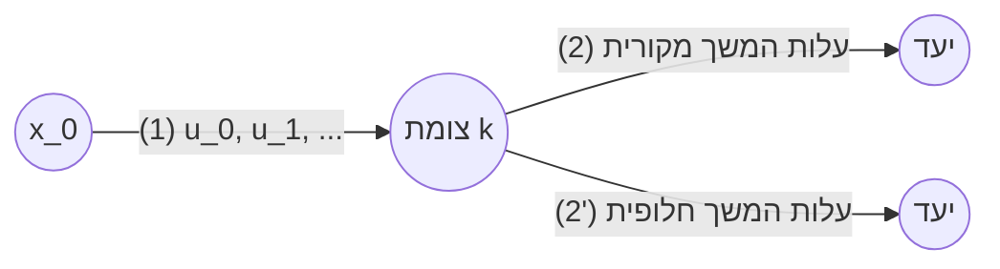

# בקרה אופטימלית – סיכום לוח מלא: הרצאה 1 (00:00 – 164:38)

> **חולץ ושוחזר באופן מלא מהלוח באמצעות `whiteboard_extractor.py` (שיטת `temporal_deocclusion` ו-YOLOv8-seg)**
> קובץ מקור: `בקרה אופטימלית - שעור 1 _ דף הבית.mp4`

---

## תוכן עניינים
1. [0. מבוא ומתמטיקה בסיסית (00:00 – 52:00)](#0-מבוא-ומתמטיקה-בסיסית-0000--5200)
   * [0.1 אופרטורים (Operators)](#01-אופרטורים-operators)
   * [0.2 פונקציונל (Functional)](#02-פונקציונל-functional)
   * [0.3 נגזרת מכוונת – נגזרת פרשה / גאטו (Directional Derivative)](#03-נגזרת-מכוונת--נגזרת-פרשה--גאטו-directional-derivative)
   * [0.4 דוגמה בסיסית: מינימיזציה של תבנית ריבועית](#04-דוגמה-בסיסית-מינימיזציה-של-תבנית-ריבועית)
2. [[A] בקרה אופטימלית – זמן בדיד (52:00 – 164:38)](#a-בקרה-אופטימלית--זמן-בדיד-5200--16438)
   * [A.1 מבוא לתכנות דינמי (Dynamic Programming)](#a1-מבוא-לתכנות-דינמי-dynamic-programming)
   * [A.1.1 ניסוח בעיית בקרה אופטימלית בזמן בדיד](#a11-ניסוח-בעיית-בקרה-אופטימלית-בזמן-בדיד)
   * [A.1.2 פונקציית מחיר (Cost Function) ואילוצים](#a12-פונקציית-מחיר-cost-function-ואילוצים)
   * [A.1.3 עקרון האופטימליות של בלמן (Bellman's Principle of Optimality)](#a13-עקרון-האופטימליות-של-בלמן-bellmans-principle-of-optimality)
   * [A.1.4 דוגמה 1: עץ מסלולים – כישלון אלגוריתם חמדני וצורך בחישוב לאחור](#a14-דוגמה-1-עץ-מסלולים--כישלון-אלגוריתם-חמדני-וצורך-בחישוב-לאחור)
   * [A.1.5 דוגמה 2: פתרון שיטתי של תכנות דינמי רב-שלבי על גבי רשת מצבים (Trellis DP)](#a15-דוגמה-2-פתרון-שיטתי-של-תכנות-דינמי-רב-שלבי-על-גבי-רשת-מצבים-trellis-dp)
   * [A.1.6 דוגמה 3: פתרון אנליטי רציף של תכנות דינמי למערכת לא-לינארית](#a16-דוגמה-3-פתרון-אנליטי-רציף-של-תכנות-דינמי-למערכת-לא-לינארית)

---

## 0. מבוא ומתמטיקה בסיסית (00:00 – 52:00)

### 0.1 אופרטורים (Operators)

**נתון:** זוג מרחבים $(\mathcal{X}, \mathcal{Y})$ ואיברים $(x, y) \in (\mathcal{X}, \mathcal{Y})$.

**הגדרה – אופרטור $F$:**
$$F : \mathcal{X} \longrightarrow \mathcal{Y}$$
$$x \longmapsto y = F(x)$$

#### דוגמה 1 (אופרטור לינארי מממד סופי):
$$\mathcal{X} = \mathbb{R}^2, \qquad \mathcal{Y} = \mathbb{R}^3, \qquad F \text{ לינארי}$$

$$\begin{Bmatrix} y_1 \\ y_2 \\ y_3 \end{Bmatrix} = \begin{bmatrix} 1 & 0 \\ 0 & 1 \\ -2 & -1 \end{bmatrix} \begin{Bmatrix} x_1 \\ x_2 \end{Bmatrix}$$

#### דוגמה 2 (אופרטור אינטגרלי במרחב פונקציות):
$$\mathcal{X} = \Big\{ \text{פונקציות רציפות ב-}[0, T] \Big\}, \qquad \mathcal{Y} = \mathcal{X}$$

$$y(t) = \int_0^T e^{A\xi} B x(\xi)\, d\xi$$

כאשר ממדי המטריצות:
* $A$ בגודל $n \times n$
* $B$ בגודל $n \times 1$

---

### 0.2 פונקציונל (Functional)

**הגדרה:**
פונקציונל הוא אופרטור מהמרחב $\mathcal{X}$ אל שדה המספרים הממשיים $\mathbb{R}$:
$$f : \mathcal{X} \longrightarrow \mathbb{R}$$

#### דוגמאות לפונקציונלים:

1. **תבנית ריבועית במרחב $\mathbb{R}^n$:**
   $$f : \mathbb{R}^n \longrightarrow \mathbb{R}$$
   $$\underline{x} \longmapsto y = \underline{x}^T Q \underline{x} = \sum_{i=1}^n \sum_{j=1}^n x_i x_j q_{ij}$$
   כאשר $Q$ מטריצה המגדירה תבנית ריבועית.

2. **פונקציונל אינטגרלי ריבועי במרחב $\mathcal{L}_2^n[0, T]$:**
   $$f : \mathcal{L}_2^n[0, T] \longrightarrow \mathbb{R}$$
   $$\underline{x}(t) \longmapsto f(\underline{x}(t)) = \int_0^T \underline{x}^T(t) Q \underline{x}(t)\, dt$$

3. **פונקציונל סדרות במרחב $\ell_2$:**
   $$f : \ell_2 \longrightarrow \mathbb{R}$$
   $$x_k \longmapsto f(x_k) = \sum_{k=0}^{\infty} x_k^2$$

> **שאלה מרכזית:** איך גוזרים פונקציונל במרחב אינסופי?

---

### 0.3 נגזרת מכוונת – נגזרת פרשה / גאטו (Directional Derivative)

**נתון:**
* $\mathcal{X}$ – מרחב וקטורי
* $x \in \mathcal{X}$ – וקטור
* $f$ – פונקציונל

נבחן הפרעה בכיוון $h$:
$$f(x + \epsilon h)$$
כאשר:
* $h$ – כיוון ההפרעה
* $\epsilon$ – צעד, סקלר ($\epsilon > 0$ או $\epsilon \in \mathbb{R}$)
* $x + \epsilon h$ – פתרון קביל (Feasible)

**הגדרת הנגזרת המכוונת (גוזרים לפי $\epsilon$ ב-$\epsilon=0$):**
$$f'_\epsilon(h)\Big|_{\epsilon=0} \triangleq \frac{d}{d\epsilon} f(x + \epsilon h)\Bigg|_{\epsilon=0}$$

#### תנאי הכרחי לאופטימום:
$$\boxed{f'_\epsilon(h)\Big|_{\epsilon=0} = 0 \qquad \forall h}$$

---

### 0.4 דוגמה בסיסית: מינימיזציה של תבנית ריבועית

**נתון:**
$$f(\underline{x}) = \underline{x}^T Q \underline{x}, \qquad \underline{x} \in \mathbb{R}^n, \qquad Q^T = Q > 0$$

לכל כיוון הפרעה $\forall \underline{h} \in \mathbb{R}^n$ ולכל סקלר $\forall \epsilon \in \mathbb{R}$:
$$f(\underline{x} + \epsilon \underline{h}) = (\underline{x} + \epsilon \underline{h})^T Q (\underline{x} + \epsilon \underline{h}) = \underline{x}^T Q \underline{x} + 2\epsilon \underline{x}^T Q \underline{h} + \epsilon^2 \underline{h}^T Q \underline{h}$$

נגזור לפי $\epsilon$:
$$f'_\epsilon(\underline{h}) = \frac{d}{d\epsilon} f(\underline{x} + \epsilon \underline{h}) = 2\underline{x}^T Q \underline{h} + 2\epsilon \underline{h}^T Q \underline{h}$$

בהצבת $\epsilon = 0$:
$$f'_\epsilon(\underline{h})\Big|_{\epsilon=0} = 2\underline{x}^T Q \underline{h}$$

מהתנאי ההכרחי לאופטימום:
$$\forall \underline{h} \in \mathbb{R}^n, \qquad 2\underline{x}^T Q \underline{h} = 0 \implies \underline{x}^T Q = \underline{0}^T \implies \underline{x}^* = \underline{0}$$

*(על הלוח משורטט פרבולואיד תלת-ממדי עבור המקרה הפרטי $Q = I$, כלומר $f(x) = x_1^2 + x_2^2$, עם מינימום גלובלי יחיד בראשית הצירים).*

---

## [A] בקרה אופטימלית – זמן בדיד (52:00 – 164:38)

### A.1 מבוא לתכנות דינמי (Dynamic Programming)

### A.1.1 ניסוח בעיית בקרה אופטימלית בזמן בדיד

#### משוואות המערכת הדינמית:
$$
\begin{cases}
x_{k+1} = A_k x_k + B_k u_k \\
z_{k+1} = H_{k+1} x_{k+1}
\end{cases}
$$

#### אלמנטים של המודל:
* $A_k$ : מטריצת מעבר / מערכת בזמן $k$
* $B_k$ : מטריצת כניסת בקרה בזמן $k$
* $x_k$ : וקטור המצב (State) בזמן $k$
* $u_k$ : וקטור הבקרה (Control) בזמן $k$
* $z_{k+1}$ : וקטור המוצא / המדידות בזמן $k+1$
* $H_{k+1}$ : מטריצת המדידה

#### תנאי התחלה וסיום:
* $x_0$ : **ידוע ונתון** (מצב התחלתי).
* $u_N$ : **אינו שייך / מחוק** (האופק מסתיים ב-$x_N$, ובקרה בצעד $N$ אינה משפיעה על המסלול).

---

### A.1.2 פונקציית מחיר (Cost Function) ואילוצים

#### פונקציית מחיר $J$:
1. **מקרה פשוט (שגיאת מעקב בלבד):**
   $$J = \sum_{k=0}^{N-1} \|x_{k+1} - x_d\|^2$$

2. **מקרה כללי ריבועי (שקלול שגיאת מצב ומאמץ בקרה):**
   $$J = \sum_{k=0}^{N-1} \|x_{k+1} - x_d\|_Q^2 + \|u_k\|_R^2$$

3. **ניסוח פונקציונלי כללי (עלות שלב):**
   $$J = \sum_{k=0}^{N-1} \omega(x_{k+1}, u_k)$$
   כאשר $\omega(x_{k+1}, u_k)$ היא עלות הצעד.

#### תכונות מטריצות המשקולות:
$$Q^T = Q \ge 0 \qquad (\text{חיובית חצי-מוגדרת})$$
$$R^T = R > 0 \qquad (\text{חיובית מוגדרת בהחלט})$$

#### אילוצים (Constraints):
* **אילוץ על המצב הסופי:** $x_N = x_d$ (או קבוצת מצבים סופיים $x_N \in \mathcal{S}_f$).
* **אילוץ על הבקרה:** $\|u_k\| \le \alpha_k$ (חסם על עוצמת המפעילים בכל שלב).

#### תרשים ציר הזמן והבקרות לאורך האופק:
```
 x_0              x_1              x_2                        x_N
  ●────────────────┼────────────────┼─────────── ... ──────────●
 k=0              k=1              k=2                        k=N
  ↓                ↓                ↓                          ↓
 u_0              u_1              u_2                        u_N (אינו קיים)
```

---

### A.1.3 עקרון האופטימליות של בלמן (Bellman's Principle of Optimality)

> **היסטוריה:** פותח ע"י ריצ'רד בלמן בשנות ה-50 של המאה ה-20 (RAND Corporation, 1950s) תחת השם **Dynamic Programming (DP)**.

#### ניסוח והוכחה אינטואיטיבית מהלוח:
המרצה שרטט מסלול בזמן שמתחיל ב-$x_0$ ועובר דרך סדרת בקרות $u_0, u_1, u_2, \dots$ עד לנקודת צומת בזמן $k$:
* נסמן ב-**(1)** את חלק המסלול מראשיתו $x_0$ ועד לצומת.
* מהצומת ואילך, נבחן שני המשכים אפשריים אל היעד:
  * **(2)** – המשך המסלול המקורי.
  * **(2')** – המשך מסלול חלופי.



**הכלל שנכתב על הלוח:**
$$\text{אם } (2') \text{ יותר טוב מ-} (2), \text{ אז המסלול הכולל } (1) + (2') \text{ יותר טוב מ-} (1) + (2)$$

**מסקנה יסודית:**
חלק ממסלול אופטימלי הוא בעצמו אופטימלי!
לכן, לא ניתן לבנות מסלול אופטימלי מההתחלה לסוף ("חיפוש קדימה חמדני"), אלא **יש לפתור את הבעיה מהסוף להתחלה (Backward Induction)**.

---

### A.1.4 דוגמה 1: עץ מסלולים – כישלון אלגוריתם חמדני וצורך בחישוב לאחור

על הלוח נבנתה רשת של החלטות למעבר מנקודה $A$ לנקודה $B$ לאורך 3 שלבים, כאשר בכל צומת ההחלטה היא לנוע למעלה $U$ (Up) או למטה $D$ (Down):

```
       צעד 0            צעד 1              צעד 2
       k=0              k=1                k=2
                         
                         o ──────(0)─────── o
                        / \                / \
                       /   \              /   \
                      /     \            /     \
           ──(10)─── o ─────(0)───────── o ────(0)─── o
          /           \     / \         / \
         /             \   /   \       /   \
        /               \ /     \     /     \
 A (o)                   X──(100)─── o ──(1200)── o (B)
        \               / \         / \
         \             /   \       /   \
          \           /     \     /     \
           ───(0)─── o ────(200)─── o ────(12)─── o
                      \            / \
                       \          /   \
                        \        /     \
                         ─────── o ───(12)─── o
```

#### השוואת מסלולים מהלוח:
1. **אלגוריתם חמדני (Greedy Search):**
   * בצעד הראשון בוחר ביציאה עם עלות $0$ (למטה $D$) במקום $10$ (למעלה $U$).
   * בהמשך נקלע לקשתות בעלות מחיר כבד:
     $$J_{DUD} = 0 + 100 + 0 = 100$$
2. **הפתרון הגלובלי האופטימלי:**
   * בחירה שמתחילה בעלות מקומית גבוהה יותר ($10$ למעלה $U$):
     $$J_{UDD} = 10 + 0 + 0 = 10 < 100$$
3. **מסקנת המרצה על הלוח:**
   > **חסר שלב בפתרון:** קבלת החלטות מקומיות קדימה מובילה למסלול תת-אופטימלי.
   > **מבנה הפתרון:** יש לעבוד **מהסוף להתחלה** כדי לדעת בכל צומת את "מחיר ההמשך האופטימלי" (Cost-to-Go).

---

### A.1.5 דוגמה 2: פתרון שיטתי של תכנות דינמי רב-שלבי על גבי רשת מצבים (Trellis DP)

**נתון:**
* מערכת בעלת 3 מצבים בדידים: $x \in \{1, 2, 3\}$.
* שלבי זמן: $k = 0, 1, 2, 3$.

#### שלב אחרון ($k = 2 \longrightarrow 3$):
נתון המצב $x_2 \in \{1, 2, 3\}$. יש למזער את עלות השלב האחרון:
$$\min_{u_2} J_2(x_3, u_2)$$

מהעלויות על הלוח:
* עבור $x_2 = 1$: המעבר האופטימלי הוא $1 \to 1$ עם עלות $J_2^*(1) = 0.25$
* עבור $x_2 = 2$: המעבר האופטימלי הוא $2 \to 3$ עם עלות $J_2^*(2) = 0.10$
* עבור $x_2 = 3$: המעבר האופטימלי הוא $3 \to 2$ עם עלות $J_2^*(3) = 0.10$

וקטור העלות האופטימלית מהשלב האחרון (Cost-to-Go):
$$\boxed{J_2^*(x_2) = \begin{bmatrix} 0.25 \\ 0.10 \\ 0.10 \end{bmatrix}} \qquad \begin{matrix} 1 \to 1 \\ 2 \to 3 \\ 3 \to 2 \end{matrix}$$

---

#### שלב לפני אחרון ($k = 1 \longrightarrow 2$):
לפי עקרון האופטימליות של בלמן:
$$J_1(x_1, u_1) = w_1(x_1, u_1) + J_2^*(x_2)$$
$$J_1^*(x_1) = \min_{u_1} \Big[ w_1(x_1, u_1) + J_2^*(x_2) \Big]$$

חישוב מפורט עבור כל מצב $x_1$:
1. **אם $x_1 = 1$:**
   $$J_1 = \begin{bmatrix} 0.25 \\ 0.50 \\ 0.75 \end{bmatrix} + \begin{bmatrix} 0.25 \\ 0.10 \\ 0.10 \end{bmatrix} = \begin{bmatrix} 0.50 \\ 0.60 \\ 0.85 \end{bmatrix} \implies \boxed{J_1^*(1) = 0.50} \quad (\text{מעבר } 1 \to 1)$$

2. **אם $x_1 = 2$:**
   $$J_1 = \begin{bmatrix} 0.50 \\ 0.25 \\ 0.10 \end{bmatrix} + \begin{bmatrix} 0.25 \\ 0.10 \\ 0.10 \end{bmatrix} = \begin{bmatrix} 0.75 \\ 0.35 \\ 0.20 \end{bmatrix} \implies \boxed{J_1^*(2) = 0.20} \quad (\text{מעבר } 2 \to 3)$$

3. **אם $x_1 = 3$:**
   $$J_1 = \begin{bmatrix} 0.75 \\ 0.10 \\ 0.25 \end{bmatrix} + \begin{bmatrix} 0.25 \\ 0.10 \\ 0.10 \end{bmatrix} = \begin{bmatrix} 1.00 \\ 0.20 \\ 0.35 \end{bmatrix} \implies \boxed{J_1^*(3) = 0.20} \quad (\text{מעבר } 3 \to 2)$$

וקטור העלות האופטימלית המצטברת משלב 1 ועד הסוף:
$$\boxed{J_1^*(x_1) = \begin{bmatrix} 0.50 \\ 0.20 \\ 0.20 \end{bmatrix}} \qquad \begin{matrix} 1 \to 1 \\ 2 \to 3 \\ 3 \to 2 \end{matrix}$$

---

#### שלב ראשון ($k = 0 \longrightarrow 1$):
נתון מצב התחלתי $x_0 \in \{1, 2, 3\}$. יש לפתור:
$$J_0^*(x_0) = \min_{u_0} \Big[ w_0(x_0, u_0) + J_1^*(x_1) \Big] = \min_{u_0} \left[ w_0 + \begin{bmatrix} 0.50 \\ 0.20 \\ 0.20 \end{bmatrix} \right]$$

1. **אם $x_0 = 1$:**
   $$J_0 = \begin{bmatrix} 0.25 \\ 0.50 \\ 0.75 \end{bmatrix} + \begin{bmatrix} 0.50 \\ 0.20 \\ 0.20 \end{bmatrix} = \begin{bmatrix} 0.75 \\ 0.70 \\ 0.95 \end{bmatrix} \implies \boxed{J_0^*(1) = 0.70} \quad (\text{מעבר } 1 \to 2)$$

2. **עבור שאר המצבים ההתחלתיים ($x_0 = 2, 3$):**
   המרצה חישב באופן אנלוגי וקיבל:
   $$J_0^*(2) = 0.30$$
   $$J_0^*(3) = 0.30$$

וקטור העלות הכוללת האופטימלית לכל בעיית הבקרה:
$$\boxed{J^*(x_0) = \begin{bmatrix} 0.70 \\ 0.30 \\ 0.30 \end{bmatrix}}$$

#### שחזור המסלול האופטימלי (Forward Reconstruction):
לאחר שהטבלאות חושבו לאחור, מפעילים את המדיניות קדימה לפי המצב הנתון:
* אם התחלנו ב-$x_0 = 1$:
  $$x_0 = 1 \overset{u_0^*}{\longrightarrow} x_1 = 2 \overset{u_1^*}{\longrightarrow} x_2 = 3 \overset{u_2^*}{\longrightarrow} x_3 = 2$$
  העלות הכוללת: $0.70$.

---

### A.1.6 דוגמה 3: פתרון אנליטי רציף של תכנות דינמי למערכת לא-לינארית

**נתון מודל מערכת לא-לינארית בזמן בדיד:**
$$x_{k+1} = a x_k^2 + b u_k, \qquad b \ne 0$$

**פונקציית מחיר כוללת על פני $N$ צעדים:**
$$J = \sum_{k=0}^{N-1} x_{k+1}^2$$

**המטרה:** למזער את $J$ באמצעות סדרת בקרות $\{u_k\}_{k=0}^{N-1}$.

#### פתרון באמצעות משוואת בלמן (DP לאחור):

#### 1. שלב אחרון ($k = N-1$):
בשלב האחרון, העלות התלויה בבקרה $u_{N-1}$ היא:
$$J_{N-1} = x_N^2 = (a x_{N-1}^2 + b u_{N-1})^2$$

נמצא את הבקרה הממזערת ע"י איפוס נגזרת חלקית:
$$\frac{\partial J_{N-1}}{\partial u_{N-1}} = 2 (a x_{N-1}^2 + b u_{N-1}) \cdot b = 0$$

מכיוון ש-$b \ne 0$:
$$a x_{N-1}^2 + b u_{N-1} = 0 \implies \boxed{u_{N-1}^* = -\frac{a}{b} x_{N-1}^2}$$

והמחיר האופטימלי בשלב זה הוא:
$$\boxed{J_{N-1}^* = 0}$$

#### 2. שלב לפני אחרון ($k = N-2$):
לפי עקרון האופטימליות:
$$J_{N-2} = x_{N-1}^2 + J_{N-1}^* = x_{N-1}^2 + 0 = (a x_{N-2}^2 + b u_{N-2})^2 \qquad (**)$$

נמזער לפי $u_{N-2}$:
$$\min_{u_{N-2}} J_{N-2} = \min_{u_{N-2}} (a x_{N-2}^2 + b u_{N-2})^2$$

באיפוס הנגזרת מקבלים שוב:
$$\boxed{u_{N-2}^* = -\frac{a}{b} x_{N-2}^2}$$
$$\boxed{J_{N-2}^* = 0}$$

#### 3. אינדוקציה לכל שלבי הזמן ($k = 0, 1, \dots, N-1$):
מבנה המשוואה $(**)$ זהה בכל שלב! לכן לכל $k$:
$$\boxed{u_k^*(x_k) = -\frac{a}{b} x_k^2}$$

והמסלול שמתקבל:
$$x_{k+1} = a x_k^2 + b \left(-\frac{a}{b} x_k^2\right) = 0 \qquad \forall k \ge 0$$
$$\boxed{J^* = 0}$$

> **תובנה הנדסית שנלמדה מהדוגמה:**
> כאשר פונקציית המחיר אינה מכילה איבר קנס על מאמץ הבקרה ($R = 0$), הבקרה האופטימלית מאפסת את שגיאת המצב באופן מיידי בצעד בודד (בקרת Deadbeat). ברגע שנוסיף איבר עלות על הבקרה ($\|u_k\|_R^2$), הבקרה תהיה מתונה והאיפוס יהיה הדרגתי לאורך הזמן.
